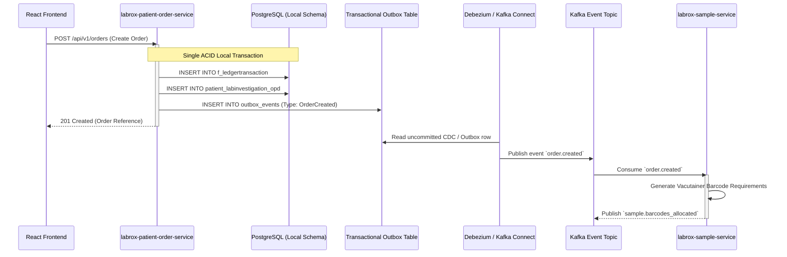

# ==============================================================================
# LabRox LIMS — Target Microservices Architecture & Technical Blueprint
# ==============================================================================
# Document Version: 1.0.0 (Phase 1 Baseline)
# System: LabRox Laboratory Information Management System
# Predecessor: eLabPro / Nanjappa LIMS (Legacy: ASP.NET Core 8 / React 18 / MySQL)
# Target Stack: Java 21 LTS / Spring Boot 3.3+ / React 18+ TS 5+ / PostgreSQL 16+ / Kafka 3+ / OpenSearch 8+ / Redis 7+
# Compliance: 21 CFR Part 11, GxP, ISO 15189, HIPAA, OWASP ASVS Level 2
# ==============================================================================

## 1. Executive Architecture Summary

**LabRox** is the next-generation, cloud-native reimplementation of the eLabPro / Nanjappa LIMS. It replaces the legacy .NET 8 monolith with an event-driven, domain-driven microservices platform engineered to process **≥10,000,000 patient records** and support **≥200 concurrent laboratory users** with:
- **Sub-second search** (p95 < 400 ms, p99 < 800 ms) via OpenSearch 8+ and Redis 7+.
- **Zero workflow or UI drift**: Exact 100% parity with legacy pages, input order, validations, medical formulas, and report outputs.
- **Enterprise resilience**: Event-driven Saga with Transactional Outbox, Kafka event streaming, and database read replicas.
- **Regulatory assurance**: 21 CFR Part 11 compliant tamper-evident, append-only, cryptographic hash-chained audit logging and PKI-based digital signatures.

---

## 2. Platform Infrastructure & C4 Container Architecture

```mermaid
flowchart TB
    Client[Browser / Barcode Scanner / Mobile Tablet] -->|HTTPS / WSS / TLS 1.3| GW[Spring Cloud Gateway :8080]
    Analyzers[Clinical Analyzers / ASTM / HL7] -->|TCP / MLLP Socket| InstSvc[labrox-instrument-service :8087]
    HospitalHIS[TrioTree / SoftMed HIS] -->|REST / HL7| GW

    subgraph Edge [Edge & Security Layer]
        GW --> OAuth[OAuth2 / OIDC / JWT Security Filter]
        GW --> RateLimiter[Redis Rate Limiter & Token Bucket]
    end

    subgraph Services [Domain Microservices Tier - Java 21 / Spring Boot 3.3]
        IAM[labrox-iam-service :8081]
        PatientOrder[labrox-patient-order-service :8082]
        Sample[labrox-sample-service :8083]
        TestCatalog[labrox-test-catalog-service :8084]
        Diagnostic[labrox-diagnostic-service :8085]
        QC[labrox-qc-service :8086]
        InstSvc
        Approval[labrox-approval-service :8088]
        Reporting[labrox-reporting-service :8089]
        Notification[labrox-notification-service :8090]
        StoreERP[labrox-store-erp-service :8091]
        B2BLedger[labrox-b2b-ledger-service :8092]
        CronJob[labrox-cron-orchestrator :8093]
    end

    Edge --> Services

    subgraph DataPlane [Data & Event Fabric Layer]
        Kafka[(Apache Kafka 3.7+ Event Fabric)]
        Postgres[(PostgreSQL 16+ Primary & Read Replicas)]
        RedisCache[(Redis 7+ Distributed L2 Cache & Locks)]
        SearchCluster[(OpenSearch 8+ Full-Text Search)]
        ObjectStore[(MinIO / AWS S3 S3-Compatible Storage)]
    end

    Services --> Postgres
    Services --> RedisCache
    Services <--> Kafka
    Services --> SearchCluster
    Reporting --> ObjectStore
    Sample --> ObjectStore

---

## 3. DDD Bounded Contexts & Microservice Specifications

### 3.1 `labrox-iam-service` (Identity, Access & 21 CFR Part 11 Audit Backbone)
- **Domain Responsibility**: User authentication, PBKDF2/Argon2id credential management, short-lived JWT generation with refresh token rotation, multi-centre role delegation (`DesignationID`), dynamic RBAC menu resolution, session state in Redis, and immutable append-only audit trail generation.
- **Data Ownership**: PostgreSQL schema `iam_schema` (`users`, `employee_master`, `designation_master`, `menumaster`, `pagemasters`, `page_accesses`, `user_login_audit`, `audit_trail_events`).
- **Kafka Events Published**:
  - `iam.user.logged_in`
  - `iam.user.failed_login`
  - `iam.password.changed`
  - `iam.audit.event_logged` (Immutable topic: 7-year retention)
- **Kafka Events Consumed**: None (Root security provider).
- **Failure Modes & Circuit Breakers**:
  - Database outage: Read-only authentication fallback via Redis cached credential tokens.
  - Brute force attack: Redis rate limiter locks account after 5 failed attempts for 15 minutes.
- **SLOs**:
  - Authentication latency: p95 < 120 ms, p99 < 250 ms.
  - Availability: 99.99%.

---

### 3.2 `labrox-patient-order-service` (Patient Registry, Order Management & Billing)
- **Domain Responsibility**: Master Patient Index (MPI), UHID auto-generation, demographic verification, test catalog ordering, package expansion, price tariff lookup (`RateTypeID`), billing invoice calculation (`f_ledgertransaction`), multi-mode split payments (Cash, Card, UPI, Cheque), advance ledger deductions, discount approvals, and refund processing.
- **Data Ownership**: PostgreSQL schema `billing_schema` (`patient_master`, `f_ledgertransaction`, `receipt`, `patient_advance_ledger`, `coupon_master`, `patient_discount_approval`).
- **Kafka Events Published**:
  - `order.created` (Payload: `LedgerTransactionNo`, `PatientID`, `TestList`, `PaymentSummary`)
  - `order.cancelled`
  - `order.refund_processed`
  - `payment.settled`
- **Kafka Events Consumed**:
  - `sample.rejected` -> Updates order item status; alerts billing desk for refund/recollection.
- **Failure Modes & Circuit Breakers**:
  - OpenSearch sync delay: Fallback to direct indexed PostgreSQL search by UHID/Mobile.
  - Payment gateway timeout: Transaction remains in `PaymentPending` status with automated reconciliation job.
- **SLOs**:
  - Order creation latency: p95 < 250 ms.
  - Availability: 99.95%.

---

### 3.3 `labrox-sample-service` (Phlebotomy, Specimen Logistics & Accessioning)
- **Domain Responsibility**: Specimen collection workflow, unique vacutainer barcode allocation (`BarcodeNo`), collection timestamping, temperature logging, courier batch manifest creation, central accessioning, department routing, specimen rejection handling, and biobanking/sample storage tracking.
- **Data Ownership**: PostgreSQL schema `sample_schema` (`sample_collection`, `sample_rejection_log`, `courier_manifest`, `sample_storage_device`, `sample_rack_box`).
- **Kafka Events Published**:
  - `sample.collected` (Payload: `BarcodeNo`, `SampleTypeID`, `CollectorID`, `Timestamp`)
  - `sample.in_transit`
  - `sample.accessioned` (Payload: `BarcodeNo`, `DepartmentID`, `ReceiverID`)
  - `sample.rejected` (Payload: `BarcodeNo`, `ReasonID`, `Notes`)
- **Kafka Events Consumed**:
  - `order.created` -> Generates pending sample collection records and barcode sequences.
- **Failure Modes & Circuit Breakers**:
  - Barcode label printer offline: Barcode number preserved; print job queued in Redis print spooler.
- **SLOs**:
  - Barcode scan lookup: p95 < 80 ms.
  - Accessioning throughput: ≥ 60 tubes / minute per bench.

---

### 3.4 `labrox-test-catalog-service` (Master Test Catalog, Reference Ranges & Formulas)
- **Domain Responsibility**: Master test definitions (`investigation_master`), analyte parameters (`labobservation_master`), age/gender/method-specific biological reference intervals (`labobservation_range`), critical panic thresholds, dynamic medical formula trees (eGFR, Indirect Bilirubin, Osmolality), and outsourcing laboratory rate lists.
- **Data Ownership**: PostgreSQL schema `catalog_schema` (`investigation_master`, `labobservation_master`, `labobservation_range`, `formula_master`, `sample_type_master`, `department_master`).
- **Kafka Events Published**:
  - `catalog.test.updated`
  - `catalog.range.updated` -> Invalidates Redis L2 reference range caches.
- **Kafka Events Consumed**: None.
- **Caching Strategy**: Entire active catalog cached in Redis with 24-hour TTL and event-driven invalidation. Zero DB reads during standard result entry.
- **SLOs**:
  - Catalog lookup latency: p95 < 25 ms (Redis hit).
  - Availability: 99.99%.

---

### 3.5 `labrox-diagnostic-service` (Clinical Results, Microbiology, Histopathology & Cytology)
- **Domain Responsibility**: Execution of quantitative and qualitative diagnostic tests, dynamic formula auto-calculation, historical delta-check variance analysis, panic value detection, microbiology culture incubation tracking, organism identification, antibiotic susceptibility testing (AST) with automated CLSI/EUCAST breakpoint interpretation, and histopathology structured gross/microscopic findings.
- **Data Ownership**: PostgreSQL schema `diagnostic_schema` (`patient_labinvestigation_opd`, `patient_labobservation_opd`, `micro_culture_growth`, `micro_organism_ast`, `histo_biopsy_details`, `delta_check_log`).
- **Kafka Events Published**:
  - `diagnostic.results.entered`
  - `diagnostic.critical_value.flagged` (High-priority alert topic)
  - `diagnostic.delta_check.failed`
- **Kafka Events Consumed**:
  - `sample.accessioned` -> Activates test item on laboratory bench worklist.
  - `instrument.reading.ingested` -> Automatically populates telemetry into test parameters.
- **Failure Modes & Circuit Breakers**:
  - Formula evaluation failure: Flags parameter with calculation error badge; preserves raw values without crashing.
- **SLOs**:
  - Result entry submission: p95 < 180 ms for 30-parameter panel.
  - Availability: 99.95%.

---

### 3.6 `labrox-qc-service` (Quality Control, Westgard Multirule Engine & Levey-Jennings)
- **Domain Responsibility**: Internal Quality Control (IQC) lot management, target mean and standard deviation configuration, real-time Westgard 6-rule evaluation (1-2s, 1-3s, 2-2s, R-4s, 4-1s, 10-x), automated bench testing lockout upon rule failure, corrective action documentation, Levey-Jennings (L-J) trend analytics, and EQAS/ILC proficiency testing.
- **Data Ownership**: PostgreSQL schema `qc_schema` (`qc_control_lot`, `qc_assay_target`, `qc_run_data`, `qc_westgard_violation`, `qc_corrective_action`).
- **Kafka Events Published**:
  - `qc.run.evaluated`
  - `qc.run.violation_detected` -> Broadcasts lockout signal to instrument bench.
  - `qc.lockout.cleared`
- **Kafka Events Consumed**:
  - `instrument.reading.ingested` (When `SampleType == 'CONTROL'`) -> Ingests QC run telemetry.
- **SLOs**:
  - Westgard statistical evaluation: p95 < 30 ms.
  - Availability: 99.95%.

---

### 3.7 `labrox-approval-service` (Verification Engine, Auto-Validation & Digital Signatures)
- **Domain Responsibility**: Multi-tier clinical verification (Medical Technologist -> Resident -> Pathologist), rule-based auto-approval engine (`AutoApproval`), sample re-run and hold management, digital signature authorization ceremony, encrypted signature stamping, and 21 CFR Part 11 electronic signature compliance.
- **Data Ownership**: PostgreSQL schema `approval_schema` (`approval_audit`, `auto_approval_rule`, `doctor_signature_keystore`, `report_revision_log`).
- **Kafka Events Published**:
  - `approval.test.approved` (Triggers asynchronous PDF generation and patient notification)
  - `approval.test.held`
  - `approval.test.rerun_ordered`
  - `approval.test.amended`
- **Kafka Events Consumed**:
  - `diagnostic.results.entered` -> Evaluates auto-approval eligibility criteria in real time.
- **Failure Modes & Circuit Breakers**:
  - Keystore unavailable: Falls back to secondary secure signature cache with strict audit log.
- **SLOs**:
  - Approval transaction latency: p95 < 150 ms.
  - Availability: 99.99%.

---

### 3.8 `labrox-instrument-service` (ASTM E1381/E1394, HL7 v2.x & Analyzer Ingestion)
- **Domain Responsibility**: Bidirectional and unidirectional interfacing with automated laboratory analyzers over TCP/IP and RS-232 serial sockets. Handles ASTM E1381/E1394 data framing, HL7 v2.x query-response host queries, barcode resolution, and raw telemetry ingestion into Kafka.
- **Data Ownership**: PostgreSQL schema `instrument_schema` (`machine_master`, `machine_param_mapping`, `mac_data_raw`, `machine_error_log`).
- **Kafka Events Published**:
  - `instrument.reading.ingested` (Partitioned by `Machine_ID`)
  - `instrument.host_query.received`
- **Kafka Events Consumed**: None.
- **Failure Modes & Circuit Breakers**:
  - Network disconnection: Local ring buffer stores up to 50,000 analyzer frames; auto-flushes on reconnect.
- **SLOs**:
  - Host query response latency: p95 < 20 ms.
  - Ingestion throughput: ≥ 500 frames / second.

---

### 3.9 `labrox-reporting-service` (Document Generation Factory — PDF & Excel)
- **Domain Responsibility**: High-speed, high-fidelity rendering of all 318 clinical lab reports, patient receipts, invoices, store purchase orders, and MIS spreadsheets. Enforces pixel-perfect layout parity with legacy templates, multi-page letterhead stamping, biological reference interval tables, and dynamic verification QR codes.
- **Engine Architecture**: JasperReports 7+ / OpenPDF for structured clinical documents + Puppeteer headless Chromium cluster for graphic Smart Reports + Apache POI / FastExcel for streaming multi-sheet workbooks.
- **Data Ownership**: Storage metadata in `reporting_schema` (`report_generation_queue`, `s3_document_metadata`). Artifacts stored in MinIO / S3.
- **Kafka Events Published**:
  - `report.pdf.generated` (Payload: `LedgerTransactionNo`, `S3Key`, `FileHash`, `ExpiryDate`)
- **Kafka Events Consumed**:
  - `approval.test.approved` -> Automatically generates clinical report PDF.
  - `order.created` -> Generates patient billing receipt.
- **Failure Modes & Circuit Breakers**:
  - Chromium crash: Auto-restarts worker pool; falls back to Java native OpenPDF renderer.
- **SLOs**:
  - Single report PDF generation: < 800 ms.
  - 100,000-row Excel export: < 30 s (streamed).

---

### 3.10 `labrox-notification-service` (Telecommunications & Multi-Channel Dispatch)
- **Domain Responsibility**: Delivery of clinical reports, critical value alarms, billing receipts, and appointment reminders across SMS (CDAC / gateway), WhatsApp Business Cloud API, and SMTP Email with PDF attachment.
- **Data Ownership**: PostgreSQL schema `notification_schema` (`notification_queue`, `notification_delivery_log`, `url_shortener_mapping`).
- **Kafka Events Published**:
  - `notification.delivered`
  - `notification.failed`
- **Kafka Events Consumed**:
  - `report.pdf.generated` -> Initiates automated patient delivery pipeline.
  - `diagnostic.critical_value.flagged` -> Dispatches immediate SMS to attending clinician.
- **SLOs**:
  - Dispatch initiation: < 2 seconds from event receipt.
  - Availability: 99.95%.

---

### 3.11 `labrox-store-erp-service` (Materials Management, Requisitions, PO, GRN & Expiry)
- **Domain Responsibility**: Supply chain management for laboratory reagents, consumables, and control vials. Handles departmental requisitions (`store_indent`), vendor quotations, Purchase Orders (PO), Goods Receipt Note (GRN) quality inspection, batch expiry tracking, stock valuation, and automated consumption calculation per diagnostic test.
- **Data Ownership**: PostgreSQL schema `store_schema` (`store_item_master`, `store_stock_master`, `store_indent`, `store_po`, `store_grn`, `vendor_master`).
- **Kafka Events Published**:
  - `store.stock.low_reorder_level`
  - `store.item.near_expiry_warning`
- **Kafka Events Consumed**:
  - `diagnostic.results.entered` -> Decrements reagent consumption from bench sub-inventory.
- **SLOs**:
  - Reagent stock check: p95 < 50 ms.
  - Availability: 99.95%.

---

### 3.12 `labrox-b2b-ledger-service` (B2B Client Margins, Advance Ledger & Doctor Commissions)
- **Domain Responsibility**: Financial accounting for B2B collection centres, corporate panels, and referring physicians. Computes rolling advance balances, enforces credit limits during order booking, manages contract price schedules, and calculates referral doctor commission statements.
- **Data Ownership**: PostgreSQL schema `ledger_schema` (`client_ledger`, `client_credit_limit`, `doctor_share_rule`, `doctor_monthly_statement`).
- **Kafka Events Published**:
  - `b2b.credit_limit.breached`
  - `b2b.advance_balance.updated`
- **Kafka Events Consumed**:
  - `order.created` -> Debits client credit account.
  - `payment.settled` -> Credits client advance account.
- **SLOs**:
  - Credit limit verification: p95 < 30 ms.
  - Availability: 99.99%.

---

### 3.13 `labrox-cron-orchestrator` (Clustered Background Automation)
- **Domain Responsibility**: Clustered Quartz scheduler executing database-driven automated tasks: bulk PDF batching, HL7 message polling, daily TAT breach summaries, and partner booking file synchronization. Replaces legacy single-process worker with fault-tolerant, horizontally scalable virtual thread workers (Project Loom).
- **Data Ownership**: PostgreSQL schema `cron_schema` (`cron_jobs`, `qrtz_*` clustered quartz tables).
- **Execution Model**: DisallowConcurrentExecution across cluster via database locks; zero single point of failure.

---

## 4. Distributed Data Consistency, Saga & Outbox Architecture

To achieve distributed data consistency across microservices without fragile distributed two-phase commits (2PC), LabRox implements the **Transactional Outbox Pattern** combined with **Choreographed / Orchestrated Sagas**.



### 4.1 Order Cancellation & Refund Saga Compensations
- If a patient order is cancelled after sample collection:
  1. `labrox-patient-order-service` emits `order.cancellation_requested`.
  2. `labrox-sample-service` consumes event -> Cancels active barcodes, invalidates courier manifest -> Emits `sample.cancelled`.
  3. `labrox-diagnostic-service` consumes event -> Aborts active worklists -> Emits `diagnostic.aborted`.
  4. `labrox-patient-order-service` executes financial refund / credit note generation.
  5. If any step fails: Compensating transaction restores order state to `CancellationPending` and creates priority manual investigation alert.

---

## 5. 21 CFR Part 11 & GxP Technical Compliance Blueprint

### 5.1 Immutable, Tamper-Evident Hash-Chained Audit Trail
Under 21 CFR § 11.10(e), audit trails must be computer-generated, time-stamped, and secure from tampering. LabRox implements a **cryptographic hash chain** for every audit record:

\[
H_n = \text{SHA-256}(H_{n-1} \parallel \text{Timestamp} \parallel \text{UserID} \parallel \text{Action} \parallel \text{EntityID} \parallel \text{PreviousValue} \parallel \text{NewValue})
\]

- Every audit entry includes the SHA-256 hash of the immediately preceding record for that entity.
- Any manual modification, deletion, or out-of-order insertion immediately breaks the cryptographic hash verification chain.
- Audit records are mirrored in real time to an append-only WORM (Write Once Read Many) AWS S3 Glacier / MinIO bucket.

### 5.2 Electronic Signatures (§ 11.50, § 11.70)
- **Dual-Authentication Signing Ceremony**: Authorizing a clinical report requires the pathologist to enter their primary system password plus a dedicated 6-digit electronic signature PIN or biometric MFA token.
- **Printed Manifestation**: Every signed clinical document explicitly manifests:
  1. The printed name of the signer.
  2. The exact UTC date and timestamp of the signature ceremony.
  3. The formal clinical meaning/reason for signing ("Reviewed and Authorized as Primary Pathologist").
  4. Cryptographic digital certificate thumbprint validating document integrity.

---

## 6. High-Performance Engineering Blueprint (p95 < 400 ms on 10M Rows)

### 6.1 Elimination of `OFFSET` via Keyset / Cursor Pagination
Legacy SQL queries utilized `LIMIT 50 OFFSET 50000`, forcing the MySQL storage engine to read 50,050 index entries. LabRox strictly enforces **Keyset (Seek) Pagination**:

```sql
-- Target High-Performance Keyset Pagination
SELECT t.Test_ID, t.LedgerTransactionNO, t.BarcodeNo, t.ItemName, t.Status
FROM patient_labinvestigation_opd t
WHERE t.CompanyId = :companyId
  AND t.DepartmentID = :deptId
  AND t.Test_ID > :lastSeenId
ORDER BY t.Test_ID ASC
LIMIT :pageSize;
```
- Query execution time remains constant (< 10 ms) regardless of whether paginating page 1 or page 50,000.

### 6.2 Composite Database Indexing Derived from Real Workloads
```sql
-- Core Composite Indexes on PostgreSQL
CREATE INDEX CONCURRENTLY idx_pli_search ON patient_labinvestigation_opd (CompanyId, DepartmentID, Approved, IsSampleCollected, Test_ID);
CREATE INDEX CONCURRENTLY idx_pli_barcode ON patient_labinvestigation_opd (CompanyId, BarcodeNo);
CREATE INDEX CONCURRENTLY idx_ledgertnx_date ON f_ledgertransaction (CompanyId, DATE DESC, LedgertransactionID);
CREATE INDEX CONCURRENTLY idx_patient_lookup ON patient_master (CompanyId, Mobile, PatientCode);
CREATE INDEX CONCURRENTLY idx_mac_sync ON mac_data (isSync, Centreid, dtEntry);
```

### 6.3 OpenSearch 8+ Full-Text & Faceted Search Pattern
- Patient demographics and order summaries are continuously synchronized from PostgreSQL to OpenSearch via Debezium + Kafka Connect.
- Multi-field searches (`Patient Name`, `Mobile`, `UHID`, `Lab No`, `Barcode`) execute against OpenSearch with `edge_ngram` analyzers, returning full auto-complete results in **< 80 ms** over 10 million documents.

### 6.4 Redis 7+ Cache-Aside Architecture
- **Layer 1 (L1)**: Caffeine in-memory cache inside each Spring Boot instance (1,000 items, 5 min TTL) for hot master records.
- **Layer 2 (L2)**: Clustered Redis 7+ storing pre-computed tariff rate lists, biological reference ranges, and menu permissions.
- Invalidation: Kafka catalog update events instantly invalidate specific Redis cache keys across all cluster nodes.

---

## 7. Frontend Modernization & Strict UI Parity Architecture

The frontend (`labrox-frontend`) is structured as a modern React 18+ TypeScript application engineered for maximum rendering performance while strictly preserving legacy visual appearance:

- **State Management**: TanStack Query 5 (server state, caching, background refetching) + Redux Toolkit 2.6 (client session, active centre, UI modals).
- **Form Architecture**: React Hook Form 7 + Zod 3 (zero re-render form typing, instantaneous inline validation).
- **Data Grids**: Virtualized TanStack Table 8 rendering grids with 100,000+ rows smoothly at 60 fps using DOM virtualization.
- **Visual Styling & Themes**: Legacy CSS/AdminLTE 3 themes preserved and modernised via clean CSS modules / styled components. Support for dark/light themes and WCAG 2.1 AA accessibility.
- **Date Handling**: Native `date-fns` 4.x (zero `moment.js` usage).
