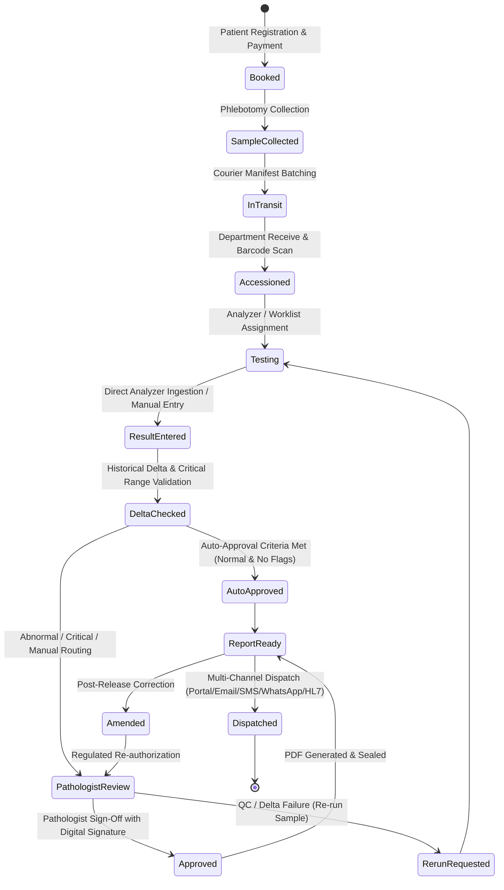
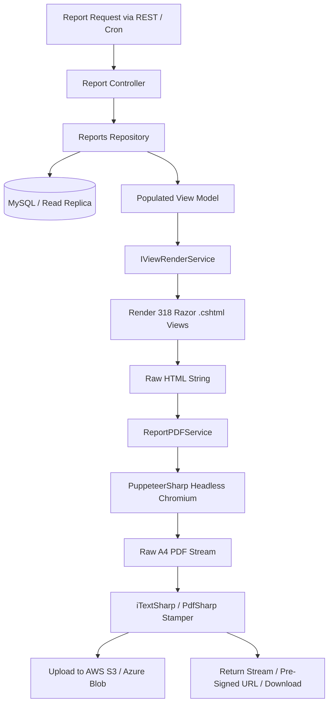

# ==============================================================================
# eLabPro / Nanjappa LIMS — Deep Discovery & Comprehensive System Inventory
# ==============================================================================
# Document Version: 1.0.0 (Phase 0 Baseline)
# System: eLabPro / Nanjappa LIMS (Legacy: ASP.NET Core 8 / React 18 / MySQL)
# Target Architecture: Cloud-Native Microservices (Java 21 LTS / Spring Boot 3.x / React 18+ TS / PostgreSQL 16+ / Kafka / OpenSearch / Redis)
# Regulatory Compliance: 21 CFR Part 11, GxP, ISO 15189, HIPAA, OWASP ASVS Level 2
# ==============================================================================

## Executive Summary

This document constitutes the formal **Phase 0 Deep Discovery Specification** for the total re-platforming of the **eLabPro / Nanjappa Laboratory Information Management System (LIMS)**. The legacy system comprises four core codebases:
1. **Frontend (`fe_v9`)**: React 18.2.0, Vite 6.2, AdminLTE 3 theme, Bootstrap 5, Material-UI 7.3, PrimeReact 10.9, Redux Toolkit 2.6, Formik/Yup, i18next (14 languages), with **650+ routes** and **1,354 JSX components**.
2. **Backend API (`nanjappa_api_v9`)**: ASP.NET Core 8 Web API utilizing Dapper over MySQL, comprising **206 Core API Controllers** and **55 Store/ERP Controllers** serving **3,097 REST endpoints**.
3. **Reports & Document Generation Service (`nanjappa_reports_v9`)**: ASP.NET Core 8 Web API + MVC Razor engine, containing **47 Report Controllers** serving **270 REST endpoints**, driving **318 Razor `.cshtml` templates** executed via PuppeteerSharp (headless Chromium HTML-to-PDF) and ClosedXML (Excel).
4. **Automation & Background Worker (`elabpro-cronjobs` / `nanjappa_cronJob`)**: .NET 8 Worker Service utilizing Quartz.NET 3.15, managing **31 scheduled background worker jobs** executing work queues powered by MySQL stored procedures.

The entire platform serves multi-tenant, high-volume clinical reference laboratories, hospital networks (Nanjappa Hospital / Nanjappa Health Care, PathCare Kenya / PKL, Pacific Diagnostics, LDPL, Metropolis, SoftMed), managing the complete lifecycle of clinical pathology, microbiology, histopathology, cytology, immunohistochemistry (IHC), radiology, quality control (IQC/EQAS), inventory store ERP, and multi-tier billing.

---

## 0.1 Full System Inventory

### 0.1.1 Backend Modules & API Surface Inventory

The backend API surface is partitioned into three major controller hierarchies across two running services:
- **Core LIMS API (`elabpro/Controllers`)**: 206 controllers, 2,750+ endpoints.
- **Store & Inventory ERP API (`elabpro/Store/Contollers`)**: 55 controllers, 340+ endpoints.
- **Reporting Service API (`reports_v9/Controllers`)**: 47 controllers, 270 endpoints.
**Total Backend Surface: 308 Controllers, 3,367 Endpoints.**

#### Functional Subsystem Inventory:

| Subsystem Domain | Primary Controllers | Key Endpoints / Responsibilities |
|---|---|---|
| **Identity & Access Management (IAM)** | `LoginController`, `usersController`, `changePasswordController`, `ChangeOtherEmpPasswordController`, `ForgetPasswordController`, `TokenGenerationRepositoryController`, `ValidateTokenRepositoryController`, `MenuController`, `CentreAccessController` | User login (`GetUserLoginDetails`), JWT issue, session cookies, password hashing (SHA-256), multi-centre access delegation, dynamic RBAC menu resolution (`MainMenuPageData`). |
| **Patient Demographics & Registration** | `PatientRegistrationController`, `PatientBaseController`, `BookingController`, `BulkRegistrationController`, `PreRegistrationController`, `DemographicController`, `IDMasterController` | Patient demographic creation (`patient_master`), UHID generation, national ID verification, bulk CSV/Excel registration, appointment slot booking. |
| **Orders, Pricing & Billing** | `RateListController`, `RateListScheduleController`, `RateTypeController`, `RateTypeDiscountController`, `RateListDiscountController`, `DiscountMasterController`, `CouponMasterController`, `CouponMasterApprovalController`, `DiscountAfterBillController`, `RefundAfterBillController`, `PaymentModeController`, `PaymentGatewayController`, `RazorPayController`, `ICICIPaymentGatewayController`, `SettlementController`, `ChangePaymentModeController`, `ChangeCreditToCashController`, `CoPaymentController`, `EstimatebilldetailController` | Test catalog tariff lookup, B2B/B2C panel rate resolution, itemized discounts, manager discount approvals, multi-mode receipts (`f_ledgertransaction`), payment gateway webhooks, billing refunds and adjustments. |
| **Phlebotomy, Accessioning & Sample Logistics** | `SCController` (Sample Collection), `SampleReceiveBarcodeController`, `BarcodeQueueController`, `ChangeBarcodeController`, `changeSampleStatusController`, `ChangeSampleStatusDataController`, `DepartmentReceiveController`, `LogisticController`, `LogisticWebController`, `DispatchController`, `ApproveDispatchController`, `RouteMasterController`, `FieldBoyMasterController`, `PhelebotomistMasterController`, `PhelebotomistMappingController`, `PhelbomistCallTransferController`, `TemporaryPhelebotomistController` | Barcode assignment, TRF (Test Request Form) generation, phlebotomy collection timestamps, courier batching, manifest printing, department accessioning, sample reruns, recollects, transit temperature logs. |
| **Clinical Diagnostic Testing & Worksheets** | `InvestigationsController`, `InvestigationRequiredMasterController`, `InvestigationCommentMasterController`, `ItemMasterInterfaceController`, `TestDataController`, `WorkSheetOrderController`, `FormulaMasterController`, `TestCentreMappingControllerController`, `OutSourceTestToOtherLabController`, `OutSourceLabMasterController` | Test/Profile/Package master data, parameter formulas (e.g. eGFR, Anion Gap, Indirect Bilirubin), worklist/worksheet generation, laboratory outsourcing workflows. |
| **Clinical Result Entry & Telemetry** | `REController` (Result Entry), `macdataController`, `MachineMasterController`, `MachineGroupController`, `machineReferencesRangesTransferController` | Parameterized numeric result entry, historical delta check comparison, analyzer interface telemetry ingestion (`mac_data`), instrument reference range auto-validation, critical alert triggers. |
| **Specialized Diagnostic Modalities** | `RECultureController`, `MicroMasterController`, `MapMicroMasterController`, `HistoCytoController`, `HistoTemplateMasterController`, `IHCController`, `IHCResultentryController`, `REAllergyController`, `RadiologyController`, `RediologyResultEntryController`, `ModalityMasterController`, `MacRadiologyController` | Microbiology culture staging & Antibiotic Susceptibility Testing (AST/MIC), Histopathology grossing & block tracking, IHC antibody scoring, Allergy allergen panels, PACS/DICOM radiology reporting. |
| **Quality Control (QC) & Westgard Engine** | `QCController`, `QCMicroController`, `QCApprovalRightController`, `IQCControlCentreMappingController`, `IQCQualityQuestionMasterController`, `IQCQualityQuestionAnswerController`, `IQCWestgardRuleMasterController`, `QCRemarksMasterController`, `QCReportController`, `QcStatusController`, `QCTransferControlDetailsController`, `QcUploadController`, `QCValueEntryController`, `QCValueEntryMicroController`, `QualitativeQCProcessController`, `QCHistoInterlabController`, `EQASController`, `ILCController` | Control lot management, target mean & SD configuration, Westgard 6-rule validation (1-2s, 1-3s, 2-2s, R-4s, 4-1s, 10-x), Levey-Jennings plots, inter-lab comparisons, EQAS proficiency reporting. |
| **Verification, Sign-off & Audit Trail** | `DoctorApprovalController`, `ManageApprovalController`, `InvestigationAutoApprovalMasterController`, `InvestigationAutoApproveMasterController`, `ChangeResultStatusController`, `CancelReportController`, `AuditTrailController`, `ResultAmendmentController`, `ResultChangeLogController` | Rule-based auto-approval engine, resident pathologist review, multi-tier digital signatures (`PrintSignature`), result amendments, 21 CFR Part 11 audit trails (`labobservation_interpretation_audit`). |
| **Materials Management & Store ERP** | `AddCategoryTypeController`, `AddSubCategoryTypeController`, `ItemTypeMasterController`, `StoreManufactureMasterController`, `StoreUnitMasterController`, `VendorMasterController`, `VendorQuotationController`, `VendorQuotationComparisonController`, `DirectPOController`, `POAgainstPIController`, `POSearchController`, `ServicePOController`, `DirectGRNController`, `EditDirectGRNController`, `GRNFormPOController`, `GRNStatusController`, `DirectIssueController`, `StoreIndentIssueController`, `StoreCreateSalesIndentController`, `IndentReceiveController`, `StockPhysicalVerificationController`, `StockExpiryChangeController`, `ConsumeStoreItemController` | Store requisition, supplier quotation matrix, Purchase Order (PO) workflow, Goods Receipt Note (GRN) inspection, stock valuation, department issue, direct transfer, batch expiry tracking, physical audit reconciliation. |
| **B2B Partner & Doctor Commission Engine** | `AdvanceB2BController`, `B2BConnect_LoginController`, `CentreShareController`, `CentreTypeShareController`, `DocShareMasterController`, `DoctorShareController`, `DoctorreferalController`, `DoctorMisController`, `RateTypeShareController`, `RateTypeCommissionController`, `SalesManagerController`, `SalesFunnelController`, `SalesHierarchyController`, `TargetSheetController` | B2B franchise billing, rolling advance ledger, client credit limit enforcement, doctor referral revenue sharing calculations, sales hierarchy quotas. |
| **Reporting & Document Generation Service** | `LabReportController`, `ReportsController`, `receiptController`, `EstimatebilldetailController`, `SmartReportController`, `StoreReportsController`, `FinanceReportsController`, `TATMISController`, `CollectionReportController`, `CentreShareReportController`, `DoctorLedgerReportController`, `InvoiceRollingAdvanceLedgerController`, `OutSourceController`, `ResultChangeLogController`, `NPLReportController` | Razor view rendering (`IViewRenderService`), PuppeteerSharp PDF conversion, letterhead stamping, QR code watermarking, ClosedXML multi-sheet Excel generation, S3/Azure upload. |
| **Communications & Gateway Interfaces** | `EmailController`, `EmailtemplatesController`, `BankAPIController`, `CRMIntegrationController`, `MediBuddyController`, `WebSiteIntegrationController`, `StoreD365Controller`, `VendorGNextHRMSController`, `TicketingController`, `FeedBackController` | External hospital CRM integrations, MediBuddy TPA booking webhooks, Dynamics 365 ERP sync, customer feedback, helpdesk issue tracking. |

### 0.1.2 Frontend Routes, Pages & Component Hierarchy

The frontend application (`fe_v9`) is built on React 18.2 with Vite, featuring **650+ registered routes** and **1,354 JSX components** structured across 70+ feature modules. Routing is organized in `RenderRoute.jsx` and `RenderRouteEndPoints.js` guarded by `Authenticated`, `Guest`, and `B2BConnectAuthenticated` wrappers.

#### Core Frontend Module Hierarchy:

1. **Dashboards (`src/pages/Dashboards/`, `src/Frontend/FrontofficeDashboard/`, `src/Frontend/TechnicalDashboard/`, `src/Frontend/DirectorDashboard/`)**:
   - `MainDashboard.jsx`, `StoreDashboard.jsx`, `FrontofficeDashboard.jsx`, `TechnicalDashboard.jsx`, `DirectorDashboard.jsx`, `ApisDashboard.jsx`.
   - Live KPI widgets: Sample collection counts, pending accessioning, critical result alerts, TAT breach indicators, daily collection totals, analyzer status gauges.
2. **Patient Registration & Billing (`src/Frontend/Laboratory/`, `src/Frontend/Payment/`, `src/Frontend/Master/`)**:
   - `PatientRegistration.jsx`, `UHIDNewPatientRegister.jsx`, `ReceiptReprint.jsx`, `Settlement.jsx`, `RefundAfterBill.jsx`, `DiscountAfterBill.jsx`, `CreditToCash.jsx`, `ChangePaymentMode.jsx`, `BulkRegistration.jsx`, `PreRegistration.jsx`.
   - Comprehensive multi-tab registration forms with real-time barcode assignment, tariff computation, discount approvals, doctor referral auto-complete, and multi-currency payment splits.
3. **Phlebotomy, Accessioning & Logistics (`src/Frontend/Laboratory/`, `src/Frontend/LogisticsPages/`, `src/Frontend/ReciveBarcode/`)**:
   - `SampleCollection.jsx`, `DepartmentReceive.jsx`, `ReceiveBarcode.jsx`, `SampleTracking.jsx`, `LogisticRouteMaster.jsx`, `LogisticFieldBoyMapping.jsx`, `LogisticReceive.jsx`, `FieldBoyTracking.jsx`, `DispatchReport.jsx`.
   - Real-time sample state transitions, batch manifests, courier bag barcode scanning, temperature tracking, and mobile phlebotomy integration.
4. **Diagnostic Result Entry & Clinical Modalities (`src/Frontend/Laboratory/`, `src/Frontend/ImmunoHistoChemistry/`, `src/Frontend/Radiology/`, `src/Frontend/EQAS/`)**:
   - `ResultEntry.jsx`, `CombineResultEntry.jsx`, `CultureResultEntry.jsx`, `HistoCytoResultEntry.jsx`, `IHCResultEntry.jsx`, `AllergyResultEntry.jsx`, `RadiologyResultEntry.jsx`, `LabWorksheet.jsx`.
   - Parameterized grid entry with dynamic decimal precision, formula auto-evaluation, previous result delta check badges (flagging >20% shifts), critical high/low visual alarms, and rich-text template editors (CKEditor 4/5, Quill) for histopathology gross/microscopic findings.
5. **Quality Control (QC) & Westgard Engine (`src/Frontend/QualityControl/`, `src/Frontend/EQAS/`)**:
   - `QCValueEntry.jsx`, `QCValueEntryMicro.jsx`, `ControlCentreMapping.jsx`, `WestgardRuleMaster.jsx`, `QCChartViewer.jsx` (Levey-Jennings plots rendered via Chart.js / ApexCharts), `QualitativeQCProcess.jsx`, `QCHistoInterlab.jsx`, `EQASMaster.jsx`.
6. **Pathologist Verification & Approval (`src/Frontend/DoctorApproval/`, `src/Frontend/Laboratory/`)**:
   - `DoctorApproval.jsx`, `DoctorApprovalNew.jsx`, `ManageApproval.jsx`, `InvestigationAutoApproveMaster.jsx`, `ResultStatusChange.jsx`.
   - Multi-stage verification grid: Medical technologist review -> Senior Resident review -> Chief Pathologist sign-off. Bulk signing capability, signature image preview, rejection notes, and instant patient report release.
7. **Report Management & Dispatch (`src/Frontend/Reports/`, `src/Frontend/SmartReport/`, `src/Frontend/CombineReport/`)**:
   - `CommonReports.jsx`, `SmartReport.jsx`, `CombineReports.jsx`, `WorksheetReport.jsx`, `EmailDeliveryReport.jsx`, `TATMISReport.jsx`, `DailyCollectionReport.jsx`.
   - Filtering criteria, multi-column dynamic grids (TanStack / rc-easyui / PrimeReact), inline PDF preview modal, thermal receipt triggers, instant WhatsApp/SMS resend.
8. **Materials Management & Store ERP (`src/Frontend/Store/`, `src/Frontend/EquipmentManagement/`)**:
   - `CreateIndent.jsx`, `IndentIssue.jsx`, `VendorQuotation.jsx`, `VendorQuotationComparison.jsx`, `DirectPO.jsx`, `DirectGRN.jsx`, `GRNApproval.jsx`, `DirectStockTransfer.jsx`, `StockPhysicalVerification.jsx`, `ConsumeStoreItem.jsx`, `StoreItemMasterUpdate.jsx`.
   - End-to-end supply chain management for lab reagents, consumables, and control vials with expiry warnings and minimum reorder level alerts.
9. **Master Data & Administrative Controls (`src/Frontend/Master/`, `src/Frontend/Administrator/`, `src/Frontend/CompanyMaster/`)**:
   - `InvestigationMaster.jsx`, `RateTypeMaster.jsx`, `CentreMaster.jsx`, `DoctorMaster.jsx`, `EmployeeMaster.jsx`, `MenuMaster.jsx`, `PageMaster.jsx`, `RoleAccessMaster.jsx`, `MachineMaster.jsx`, `ReferenceRangeMaster.jsx`, `FormulaMaster.jsx`.
10. **B2B Client Portal & Financial Accounting (`src/Frontend/B2BConnect/`, `src/Frontend/Finance/`, `src/Frontend/CashFlow/`)**:
    - `B2BClientDashboard.jsx`, `AdvanceRollingLedger.jsx`, `InvoiceGeneration.jsx`, `DoctorShareMaster.jsx`, `CentreShareMaster.jsx`, `PettyCashMaster.jsx`, `CashFlowSummary.jsx`.

---

### 0.1.3 Cronjob Automation Suite Inventory

The background worker platform (`elabpro-cronjobs`) executes **31 mission-critical background jobs** managed by Quartz.NET 3.15. The schedule definitions are stored dynamically in the MySQL database table `cron_jobs` and reloaded at boot.

| Job Class Name | Queue Source (SP / Query) | Execution Cadence | Core Business Purpose & Action |
|---|---|---|---|
| `labreport_generation_bulk` | `sp_LabReportPrint_Queue` | Every 1-2 min (`0 0/1 * * * ?`) | Renders clinical lab report PDFs in parallel (bounded by `SemaphoreSlim` to CPU/2), applies company letterheads & QR codes, pushes artifacts to AWS S3/Azure Blob, marks queue rows completed. |
| `labreport_generation_poct` | `sp_LabReportPrint_Queue` | Every 2 min | Point-of-Care Testing (POCT) report PDF generation and rapid cloud storage dispatch. |
| `sync_machine_data` | `sync_MachineData_Pending` | Every 30-60 sec | Consumes raw analyzer readings from `mac_data`, parses ASTM/HL7 test code mappings, inserts verified telemetry directly into `patient_labinvestigation_opd`. |
| `push_email` | `get_NotificationQueue (Type='Email')` | Every 1 min | Pulls queued patient/client emails, attaches generated clinical PDFs or billing receipts, delivers via configured SMTP relay. |
| `push_email_nanjappa` | `get_NotificationQueue` | Every 1 min | Nanjappa hospital-specific branded email dispatcher with hospital header templates. |
| `push_email_npl` | `get_NotificationQueue`, `sp_InsertMembershipRenewalAlerts` | Every 2 min | NPL laboratory-specific email alerts, including membership card renewal notifications. |
| `push_sms` / `push_sms_npl` | `get_NotificationQueue (Type='SMS')` | Every 30 sec | Dequeues patient SMS alerts, constructs CDAC / SMS gateway HTTP payloads, executes REST calls, tracks delivery status. |
| `push_whatsapp_reports` | `push_whatsapp_reports` | Every 1 min | Sends approved lab report notifications via WhatsApp Cloud API / partner gateways with encrypted short download links. |
| `pkl_whatsapp` / `push_whatsapp_pkl` | `get_NotificationQueue` | Every 1 min | PathCare Kenya Limited (PKL) specialized WhatsApp delivery engine. |
| `push_sample_status_to_triotree` | `sp_HL7_outgoing_queue` | Every 1 min | Extracts sample collection, accessioning, and approval events, formats HL7 ORU/ORM messages, pushes status updates to TrioTree Hospital Information System (HIS). |
| `sync_booking_hl7` | `sync_booking_hl7` | Every 1 min | Consumes inbound HL7 booking/order messages from hospital partner interfaces and populates `booking_data`. |
| `sync_booking_data` / `sync_booking_data_npl` | File system drop folder / `sync_booking_data` | Every 5 min | Monitors SFTP / network drop folders for batch CSV/Excel booking files, validates patient schemas, and executes bulk registration. |
| `sync_report_api` | `push_LabReport_API` | Every 2 min | Extracts approved reports, base64-encodes generated PDFs, and pushes JSON payloads to third-party hospital portals (e.g. HLL AIIMS Raipur SoftMed gateway). |
| `tat_email` | `sp_DailyTATEmail` | Daily at 07:00 | Calculates Turnaround Time (TAT) breaches across all processing laboratories, formats executive summary tables, and emails laboratory directors. |
| `kra_post` | `kra_post` queue | Every 5 min | Posts patient invoice fiscal receipts and QR signatures to Kenya Revenue Authority (KRA) e-TIMS fiscal service. |
| `HomeCollectionIntegration_Pacific` | Pacific API queue | Every 2 min | Synchronizes mobile home collection requests, phlebotomist GPS assignments, and sample barcode scans from Pacific Diagnostics mobile portal. |
| `send_billing_email` | Billing invoice queue | Every 5 min | Generates and dispatches monthly B2B billing statements and credit ledger reconciliations. |
| `send_report_email` | `sp_GetReportEmail` | Every 2 min | Secondary dedicated report mailer with automated retry backoff. |
| `send_sms_to_patients` / `send_whatsapp_to_patients` | Direct messaging queue | Every 1 min | Direct notification pipelines for critical abnormal result immediate alerts. |
| `nplrc_webservice` | `sp_LabReportQueue` | Every 3 min | Synchronizes clinical diagnostic reports with Nanjappa Pathology Lab Research Centre external web services. |
| `pushemail_doctorapproval_npl` | Approval alert queue | Every 5 min | Alerts referring and consulting doctors when critical patient reports are validated. |
| `pushemail_duepatient_npl` | Financial due queue | Daily at 10:00 | Dispatches automated balance due notices to credit patients. |
| `pushemail_invoice_npl` | Patient invoice queue | Every 2 min | Automated patient receipt & tax invoice delivery. |

---

### 0.1.4 Report & Document Generation Engines

The dedicated reporting microservice (`reports_v9`) houses **318 Razor `.cshtml` templates** located in `Views/`, supported by `IViewRenderService`, `ReportPDFService`, and `S3FileServiceRepository`:
1. **Clinical Diagnostic Report Templates (`Views/LabReport/`)**:
   - `NumericTemplate_*.cshtml`: 25+ specialized layout variations accommodating different lab brands, multi-column parameter layouts, biological reference intervals (by age/gender), flag indicators (High/Low/Critical), method descriptions, and multiple pathologist signatures.
   - `Culture_*.cshtml`: Specialized microbiology templates detailing specimen source, colony count, identified pathogenic organisms, and antibiotic susceptibility matrices (Sensitive / Intermediate / Resistant / MIC values).
   - `HistoTemplate.cshtml` & `HistoTemplate_*.cshtml`: Histopathology and cytology formats detailing Clinical History, Specimen Gross Description, Microscopic Findings, Special Stains, and Pathological Impression.
   - `AllergyTemplate.cshtml`: Multi-allergen panel layouts with visual IgE antibody class severity scales (Class 0 to Class 6).
   - `SmartReportPrint.cshtml`: Health checkup package summaries incorporating visual graphical gauges (`FemalegraphRepresnt.cshtml`, `MalegraphRepresent.cshtml`) displaying organ risk profiles.
2. **Financial & Billing Documents (`Views/ReceiptInfo/`, `Views/DepartmentSlip/`, `Views/TrfInfo/`)**:
   - Patient Receipts: `NPLTemplate.cshtml`, `receipt.cshtml`, `RaylandReceipt.cshtml`, `receiptPOCT.cshtml`, `PatientReceiptNew2.cshtml` through `PatientReceiptNew4.cshtml`.
   - Test Request Forms: `TrfTemplateNanjappa.cshtml`, `TrfHeaderTemplateNanjappa.cshtml`.
   - Estimate Slips: `EstimateTemplate.cshtml`, `Estimateinfo.cshtml`.
3. **Store & Inventory Slips (`Views/StoreReportViews/`)**:
   - `POReport.cshtml`, `POReport1005.cshtml`: Formal Purchase Orders issued to suppliers with tax tables and delivery schedules.
   - `GrnReport.cshtml`, `GrnSummaryReport.cshtml`: Goods Receipt Notes with batch numbers, expiry dates, and QC acceptance signatures.
   - `IndentIssueReportPdf.cshtml`, `IndentReportPdf.cshtml`: Store requisition and internal issue manifests.
   - `StockPrint.cshtml`, `ItemStockPdf.cshtml`: Real-time stock valuation ledgers.
   - `VendorQuotationPdf.cshtml`: Vendor quotation evaluation comparisons.
4. **MIS & Operational Management Reports (`Views/CommonReports/`, `Views/TATMIS/`, `Views/FinanceReports/`)**:
   - Collection reports (DateWise, DeptWise, ClientWise, ItemWise, UserWise, Outstanding, Settlement, Refund).
   - Business analytics (ClientWiseBusinessReport, Doctor_Summary, Doctor_Detail, BusinessGrowthReport, CentreSummeryReportNPL).
   - Operational audits (TATMIS, CriticalTestReport, SampleRerunReport, DemographicChange, ResultChangeLog).

---

## 0.2 Database Architecture & Data Dictionary

The legacy database comprises **534+ tables** and **127 stored procedures** running on MySQL. Below is the comprehensive data dictionary for the mission-critical core tables, derived from schema extraction and C# repository analysis.

### 0.2.1 Core Clinical & Operational Data Dictionary

#### 1. `patient_master` (Patient Demographics & Master Identity)
*Primary identity registry for all registered patients across all laboratory centres.*

| Column Name | Legacy MySQL Type | Target PostgreSQL Type | Nullable | Constraints / FK | Semantic Description & Business Rules |
|---|---|---|---|---|---|
| `Patient_ID` | INT AUTO_INCREMENT | BIGSERIAL | NO | PK | Internal unique patient surrogate key. |
| `PatientCode` | VARCHAR(50) | VARCHAR(50) | NO | UNIQUE (PatientCode, CompanyId) | Hospital/Lab unique identifier (UHID). Formatted per tenant rules (e.g. `UHID-2026-000123`). |
| `Title` | VARCHAR(20) | VARCHAR(20) | YES | — | Salutation (`Mr`, `Mrs`, `Miss`, `Dr`, `Baby`, `Master`). |
| `FirstName` / `PName` | VARCHAR(150) | VARCHAR(150) | NO | — | Full legal name of the patient. |
| `Gender` | VARCHAR(10) | VARCHAR(10) | NO | CHECK (Gender IN ('Male','Female','Other')) | Biological sex. Critical for age/gender specific biological reference intervals. |
| `DOB` | DATE | DATE | YES | — | Date of birth. |
| `Age` | VARCHAR(20) | VARCHAR(20) | NO | — | Human-readable age string (e.g. `34 Y 2 M 15 D`). |
| `AgeYear` / `AgeMonth` / `AgeDays` | INT | INT | YES | — | Normalized age components. |
| `TotalAgeInDays` | INT | INT | NO | INDEX | Total lifespan in days. Used by query engine for exact reference range matching. |
| `Mobile` | VARCHAR(20) | VARCHAR(20) | YES | INDEX (Mobile, CompanyId) | Primary contact mobile number. Target for SMS and WhatsApp delivery. |
| `Email` | VARCHAR(150) | VARCHAR(150) | YES | — | Primary email address for lab report delivery. |
| `House_No` / `StreetName` | VARCHAR(255) | VARCHAR(255) | YES | — | Residential address lines. |
| `Locality` / `City` / `State` | VARCHAR(100) | VARCHAR(100) | YES | — | Geographic hierarchy for epidemiological and regional reporting. |
| `PinCode` | VARCHAR(20) | VARCHAR(20) | YES | — | Postal postal code. |
| `CountryID` | INT | INT | YES | — | ISO country identifier. |
| `IsVIP` | TINYINT(1) | BOOLEAN | NO | DEFAULT FALSE | Flag for high-profile patients requiring enhanced confidentiality. |
| `MembershipCardNo` | VARCHAR(50) | VARCHAR(50) | YES | INDEX | Loyalty / Health Card number. |
| `FamilyMemberGroupID` | INT | INT | YES | INDEX | Links related patient accounts for family health plans. |
| `CompanyId` | INT | INT | NO | INDEX | Multi-tenant tenant partition identifier. |
| `centreID` | INT | INT | NO | FK -> `centre_master.CentreID` | Registration centre of origin. |
| `isActive` | TINYINT(1) | BOOLEAN | NO | DEFAULT TRUE | Soft-delete flag. |
| `dtEntry` / `CreatedBy` | DATETIME / INT | TIMESTAMPTZ / INT | NO | — | Audit creation timestamp and user ID. |

---

#### 2. `f_ledgertransaction` (Billing Invoices & Order Header)
*Financial transaction header recording test orders, gross billing, discounts, net amount, and payment status.*

| Column Name | Legacy MySQL Type | Target PostgreSQL Type | Nullable | Constraints / FK | Semantic Description & Business Rules |
|---|---|---|---|---|---|
| `LedgertransactionID` | INT AUTO_INCREMENT | BIGSERIAL | NO | PK | Internal unique financial order surrogate key. |
| `LedgerTransactionNo` | VARCHAR(50) | VARCHAR(50) | NO | UNIQUE (LedgerTransactionNo, CompanyId) | Public-facing Lab / Order Number (e.g. `LAB202611030001`). Displayed on barcodes & receipts. |
| `Patient_ID` | INT | BIGINT | NO | FK -> `patient_master.Patient_ID` | Associated patient foreign key. |
| `PatientCode` | VARCHAR(50) | VARCHAR(50) | NO | INDEX | UHID snapshot at order creation. |
| `PName` / `Age` / `Gender` | VARCHAR | VARCHAR | NO | — | Patient demographic snapshot preserved at bill generation for regulatory immutability. |
| `DATE` / `dtEntry` | DATETIME | TIMESTAMPTZ | NO | INDEX | Timestamp of booking / invoice creation. |
| `centreID` / `CentreName` | INT / VARCHAR | INT / VARCHAR | NO | FK -> `centre_master.CentreID` | Order billing centre. |
| `Panel_ID` / `PanelName` | INT / VARCHAR | INT / VARCHAR | NO | FK -> `centre_master.CentreID` | B2B Client / Insurance Panel responsible for billing. |
| `Doctor_ID` / `DoctorName` | INT / VARCHAR | INT / VARCHAR | YES | FK -> `doctor_referal.Doctor_ID` | Referring doctor identifier and name. |
| `RateTypeId` / `RateTypeName`| INT / VARCHAR | INT / VARCHAR | NO | FK -> `rate_type_master.RateTypeID` | Price tariff category applied (Standard, Corporate, CGHS, B2B). |
| `GrossAmount` | DECIMAL(14,4) | NUMERIC(14,4) | NO | — | Sum of test catalog rates before discount. |
| `DiscountOnTotal` | DECIMAL(14,4) | NUMERIC(14,4) | NO | DEFAULT 0 | Authorized bill-level discount amount. |
| `NetAmount` | DECIMAL(14,4) | NUMERIC(14,4) | NO | — | Net payable amount: `GrossAmount - DiscountOnTotal`. |
| `Adjustment` | DECIMAL(14,4) | NUMERIC(14,4) | NO | DEFAULT 0 | Total collected amount paid at booking. |
| `AdjustmentDate` | DATETIME | TIMESTAMPTZ | YES | — | Timestamp of last payment settlement. |
| `IsCredit` | TINYINT(1) | BOOLEAN | NO | DEFAULT FALSE | TRUE if balance is billed to client account on credit. |
| `BillNo` | VARCHAR(50) | VARCHAR(50) | YES | INDEX | Formal fiscal invoice number. |
| `TypeOfTnx` | VARCHAR(50) | VARCHAR(50) | NO | — | Transaction type (`LabBooking`, `OPD`, `HomeCollection`). |
| `CompanyId` | INT | INT | NO | INDEX | Multi-tenant tenant identifier. |
| `CreatedBy` / `CreatedByName`| INT / VARCHAR | INT / VARCHAR | NO | — | Identity of registration user. |

---

#### 3. `patient_labinvestigation_opd` (Test Order Items & Clinical Status Engine)
*The central operational table of the LIMS. Tracks every ordered test/panel, sample collection, department accessioning, result entry, verification, and clinical approval.*

| Column Name | Legacy MySQL Type | Target PostgreSQL Type | Nullable | Constraints / FK | Semantic Description & Business Rules |
|---|---|---|---|---|---|
| `Test_ID` | INT AUTO_INCREMENT | BIGSERIAL | NO | PK | Internal unique order-line item surrogate key. |
| `LedgertransactionID` | INT | BIGINT | NO | FK -> `f_ledgertransaction` | Order header foreign key. |
| `LedgerTransactionNO` | VARCHAR(50) | VARCHAR(50) | NO | INDEX | Lab / Order number for fast indexing. |
| `BarcodeNo` | VARCHAR(50) | VARCHAR(50) | NO | INDEX (BarcodeNo, CompanyId) | Specimen tube barcode assigned. Can be shared across tests within same vacutainer/sample type. |
| `ItemId` / `Investigation_ID` | INT | INT | NO | FK -> `investigation_master` | Ordered clinical investigation identifier. |
| `TestCode` / `ItemName` | VARCHAR | VARCHAR | NO | — | Standard clinical test mnemonic (e.g. `CBC`, `LFT`, `TSH`). |
| `DepartmentID` | INT | INT | NO | FK -> `department_master` | Laboratory specialty (Hematology, Biochemistry, Microbiology, Histopathology, etc.). |
| `SampleTypeID` / `SampleTypeName`| INT / VARCHAR | INT / VARCHAR | NO | FK -> `sample_type_master` | Biological specimen required (Serum, EDTA Whole Blood, Plasma, Urine, CSF). |
| `Rate` / `Amount` / `DiscountAmt` | DECIMAL(12,4) | NUMERIC(12,4) | NO | — | Line-item pricing breakdown. |
| `IsSampleCollected` | VARCHAR(2) | VARCHAR(2) | NO | DEFAULT 'N' | State flag: `'N'` = Pending, `'Y'` = Collected, `'R'` = Rejected. |
| `SampleDate` / `SampleCollectionBy`| DATETIME / INT | TIMESTAMPTZ / INT | YES | — | Phlebotomy collection timestamp and phlebotomist ID. |
| `SampleReceiveDate` / `SampleReceivedById` | DATETIME / INT | TIMESTAMPTZ / INT | YES | — | Central laboratory / department accessioning timestamp and accessioner ID. |
| `SampleInTransit` | TINYINT(1) | BOOLEAN | NO | DEFAULT FALSE | TRUE when sample is logged into courier manifest in transit. |
| `ResultEnteredBy` / `ResultEnteredDate` | INT / DATETIME | INT / TIMESTAMPTZ | YES | — | Technologist who entered/uploaded test findings. |
| `ResultFlag` | VARCHAR(10) | VARCHAR(10) | YES | — | Diagnostic flag: `'N'` = Normal, `'L'` = Low, `'H'` = High, `'C'` = Critical Panic Value. |
| `IsCriticalResult` | TINYINT(1) | BOOLEAN | NO | DEFAULT FALSE | Critical panic value flag triggering urgent clinician notifications. |
| `Approved` | INT | SMALLINT | NO | DEFAULT 0 | Approval state: `0` = Pending, `1` = Approved by Pathologist, `2` = Hold, `3` = Re-run. |
| `ApprovedDate` / `ApprovedDoneBy`| DATETIME / INT | TIMESTAMPTZ / INT | YES | — | Final sign-off timestamp and Pathologist user ID. |
| `AutoApproved` | TINYINT(1) | BOOLEAN | NO | DEFAULT FALSE | Flag indicating test was validated by auto-approval rules engine. |
| `isHold` / `Hold_Reason` | TINYINT(1) / VARCHAR | BOOLEAN / TEXT | YES | — | Test hold status and clinical justification. |
| `isrerun` | TINYINT(1) | BOOLEAN | NO | DEFAULT FALSE | Sample re-run requested due to QC/delta failure. |
| `isPrint` | INT | SMALLINT | NO | DEFAULT 0 | Report print count tracking. |
| `DeliveryDate` | DATETIME | TIMESTAMPTZ | YES | INDEX | Committed Turnaround Time (TAT) target completion deadline. |
| `SlideNumber` | VARCHAR(50) | VARCHAR(50) | YES | — | Unique histology/cytology cassette or glass slide identification number. |
| `CultureStatus` / `incubationdatetime` | VARCHAR / DATETIME | VARCHAR / TIMESTAMPTZ | YES | — | Microbiology culture incubation lifecycle state. |
| `CompanyId` | INT | INT | NO | INDEX | Multi-tenant tenant partition identifier. |

---

#### 4. `labobservation_master` & `labobservation_range` (Analyte Master & Biological Reference Intervals)
*Defines discrete clinical parameters and their age/gender/method-specific biological reference intervals.*

| Column Name | Legacy MySQL Type | Target PostgreSQL Type | Semantic Description & Business Rules |
|---|---|---|---|
| `LabObservation_ID` | INT AUTO_INCREMENT | BIGSERIAL | Analyte unique primary identifier (e.g. Hemoglobin, Fasting Glucose). |
| `ObservationName` | VARCHAR(150) | VARCHAR(150) | Parameter label displayed on reports. |
| `ReadingFormat` | VARCHAR(50) | VARCHAR(50) | Data format (`Numeric`, `Text`, `Heading`, `Formula`, `RichText`). |
| `DecimalPlaces` | INT | SMALLINT | Number of decimal places to format on reporting. |
| `DefaultValue` | VARCHAR(255) | VARCHAR(255) | Default text / normal baseline string. |
| `Formula` | TEXT | TEXT | Dynamic formula expression (e.g. `[101] + [102] * 0.2`). |
| `Gender` | VARCHAR(10) | VARCHAR(10) | Reference interval gender applicability (`Male`, `Female`, `Both`). |
| `FromAgeDays` / `ToAgeDays` | INT / INT | INT / INT | Exact age validity bracket in days. |
| `MinReading` / `MaxReading` | DECIMAL(12,4) | NUMERIC(12,4) | Normal biological reference interval boundaries. |
| `MinCritical` / `MaxCritical` | DECIMAL(12,4) | NUMERIC(12,4) | Panic / Critical alert thresholds triggering clinician escalation. |
| `Interpretation` | LONGTEXT | TEXT | Clinical diagnostic interpretation / methodology notes printed on report. |

---

#### 5. `mac_data` (Automated Laboratory Instrument Interface Telemetry)
*Ingestion table capturing raw telemetry from bidirectional/unidirectional clinical chemistry, hematology, and immunoassay analyzers.*

| Column Name | Legacy MySQL Type | Target PostgreSQL Type | Semantic Description & Business Rules |
|---|---|---|---|
| `ID` | INT AUTO_INCREMENT | BIGSERIAL | Primary record key. |
| `LabNo` | VARCHAR(50) | VARCHAR(50) | Specimen barcode / Lab number scanned by the analyzer. |
| `Machine_ID` | INT | INT | Unique analyzer identifier (`machine_master`). |
| `Machine_ParamID` | VARCHAR(50) | VARCHAR(50) | Raw instrument assay code transmitted via ASTM/HL7 interface. |
| `LabObservation_ID` | INT | INT | Mapped LIMS analyte identifier. |
| `Reading` | VARCHAR(100) | VARCHAR(100) | Numerical or qualitative result emitted by the analyzer. |
| `dtEntry` | DATETIME | TIMESTAMPTZ | Timestamp instrument result was received by LIMS interface. |
| `isSync` | TINYINT(1) | BOOLEAN | Processing status: `0` = Pending import, `1` = Successfully mapped to `patient_labinvestigation_opd`. |
| `Centreid` | INT | INT | Processing laboratory centre where the analyzer is situated. |

---

#### 6. `labobservation_interpretation_audit` (21 CFR Part 11 Regulatory Audit Trail)
*Immutable audit trail capturing all changes, additions, amendments, and sign-offs for clinical findings.*

| Column Name | Legacy MySQL Type | Target PostgreSQL Type | Semantic Description & Business Rules |
|---|---|---|---|
| `Audit_ID` | INT AUTO_INCREMENT | BIGSERIAL | Audit surrogate key. |
| `Test_ID` | INT | BIGINT | Target order line item key (`patient_labinvestigation_opd`). |
| `LabObservation_ID` | INT | INT | Analyte modified. |
| `OldValue` | TEXT | TEXT | Previous value prior to amendment. |
| `NewValue` | TEXT | TEXT | New updated value. |
| `ChangeReason` | VARCHAR(255) | VARCHAR(255) | Regulated clinical justification for result alteration. |
| `UserID` / `UserName` | INT / VARCHAR | INT / VARCHAR | Identity of user executing the change. |
| `dtEntry` | DATETIME | TIMESTAMPTZ | Exact UTC timestamp of change. |
| `IPAddress` | VARCHAR(50) | VARCHAR(50) | Network client IP address. |
| `ApprovedBy` | INT | INT | Pathologist re-authorizing the amendment. |

---

#### 7. `cron_jobs` (Background Automation Dynamic Schedule Catalog)
*Dynamic schedule registry configuring background Quartz jobs directly from the database.*

| Column Name | Legacy MySQL Type | Target PostgreSQL Type | Semantic Description & Business Rules |
|---|---|---|---|
| `id` | INT AUTO_INCREMENT | BIGSERIAL | Primary record key. |
| `job_key` | VARCHAR(100) | VARCHAR(100) | Unique identifier of the job instance. |
| `job_type` | VARCHAR(255) | VARCHAR(255) | Fully-qualified class name of the scheduled worker job. |
| `cron_expression` | VARCHAR(50) | VARCHAR(50) | Standard 5/6-field Quartz cron expression (e.g. `0 0/1 * * * ?`). |
| `is_enabled` | TINYINT(1) | BOOLEAN | Runtime activation switch allowing instant pause without redeployment. |
| `description` | VARCHAR(255) | VARCHAR(255) | Human-readable explanation of job responsibility. |

---

## 0.3 Laboratory Workflows & Business Logic

Every clinical workflow in eLabPro follows rigorous state transitions, multi-level validations, regulatory audit trail writes, and event side effects. Below is the operational mapping across the core clinical workflows:

### 0.3.1 Detailed Step-by-Step Workflow Specifications

#### 1. Patient Registration & Order Entry Workflow
- **User Role**: Front Office Executive / Phlebotomist / Call Center Agent.
- **Frontend Screen**: `/UHIDNewPatientRegister` or `/PatientRegistration`.
- **Inputs**:
  - Patient Demographics: Title, Full Name, Gender, DOB / Age (Years/Months/Days), Mobile Number, Email, Address, Government Identity Proof (Aadhaar / National ID / Passport).
  - Order Metadata: Centre ID, Billing Panel / Corporate Rate Type, Ordering / Referring Doctor, Urgent/STAT flag, Clinical History / TRF Attachment.
  - Test Catalog Selection: Individual Investigations (e.g. `CBC`, `HbA1c`), Profile Bundles (e.g. `LFT`, `KFT`), or Health Checkup Packages.
- **Validations**:
  - Mandatory field checks: Name, Gender, Age (>0), Mobile (10-digit format check).
  - Rate list authorization: Verify whether the chosen tests are active and unlocked for the selected `RateTypeID`.
  - Duplicate check: Search existing patients by Mobile or Government ID to prevent duplicate UHID creation.
  - Credit limit check: If billed to a corporate panel on credit, verify that the panel's outstanding balance + current order does not exceed `CreditLimit`.
- **State Transitions**:
  - Creates row in `patient_master` (if new UHID) or updates existing.
  - Generates `LedgerTransactionNo` and inserts header row in `f_ledgertransaction`.
  - Decomposes packages into individual tests and inserts ordered items into `patient_labinvestigation_opd` with status `IsSampleCollected = 'N'`.
  - Assigns unique `BarcodeNo` per sample type requirement.
- **Audit Writes & Side Effects**:
  - Inserts receipt row in `receipt` / `f_ledgertransaction`.
  - Emits notification event to phlebotomy worklist queue.
  - Thermal label printer trigger: Emits ZPL/EPL barcode command for specimen collection tubes.

---

#### 2. Phlebotomy & Sample Accessioning Workflow
- **User Role**: Phlebotomist / Accessioning Technician.
- **Frontend Screen**: `/SampleCollection` and `/DepartmentReceive` / `/ReceiveBarcode`.
- **Inputs**:
  - Scanned Barcode Number or Lab Number.
  - Phlebotomist ID, Sample Collection Timestamp, Temperature condition.
  - Specimen Acceptance / Rejection assessment (Hemolysis, Lipemia, Clotted, Insufficient Volume).
- **Validations**:
  - Barcode verification: Ensure scanned barcode matches tests mapped to the order.
  - Rejection mandatory rule: If specimen is rejected, a predefined `RejectionReason` must be chosen.
- **State Transitions**:
  - **Phlebotomy**: `patient_labinvestigation_opd.IsSampleCollected = 'Y'`, `SampleDate = NOW()`, `SampleCollectionBy = UserID`.
  - **Accessioning**: `patient_labinvestigation_opd.SampleReceiveDate = NOW()`, `SampleReceivedById = UserID`.
  - **Rejection**: `patient_labinvestigation_opd.IsSampleCollected = 'R'`, `IsRejected = 1`, `RejectionReason = Reason`. Status notification sent to ordering doctor for recollection.
- **Side Effects**:
  - If courier dispatch is involved: Batches sample into `dispatch_detail` manifest with driver ID.
  - Department slip auto-printed for the processing bench.

---

#### 3. Clinical Result Entry & Instrument Telemetry Ingestion Workflow
- **User Role**: Laboratory Technologist / Automated Analyzer Interface.
- **Frontend Screen**: `/ResultEntry` or `/CombineResultEntry`.
- **Inputs**:
  - Automatic: Telemetry stream from `mac_data` mapped by `LabNo` + `Machine_ParamID`.
  - Manual: Numeric parameter values, observation dropdowns, or microscopic text descriptions.
- **Validations**:
  - Input type check: Numeric values strictly validated against `DecimalPlaces`.
  - Biological Range Comparison: Values compared against `labobservation_range` for patient's age and gender:
    - Normal -> Flag `N`.
    - Below MinReading -> Flag `L` (Low, highlighted in blue/yellow).
    - Above MaxReading -> Flag `H` (High, highlighted in orange).
    - Beyond MinCritical / MaxCritical -> Flag `C` (Critical Panic, highlighted in red + acoustic alert).
  - Delta Check: Historical result comparison against prior visits within 30-90 days. If variance > 20%, delta check warning flag is raised.
  - Dynamic Formula Evaluation: Dependent parameters (e.g. Globulin = Total Protein - Albumin; eGFR = CKD-EPI formula) calculated immediately upon input of upstream variables.
- **State Transitions**:
  - Updates `patient_labinvestigation_opd.ResultEnteredBy = UserID`, `ResultEnteredDate = NOW()`.
  - Inserts / updates row in `patient_labobservation_opd`.
- **Audit Writes**:
  - Every update logs previous vs new value into `labobservation_interpretation_audit`.

---

#### 4. Quality Control (QC) & Westgard Multirule Evaluation Workflow
- **User Role**: Quality Control Manager / Bench Technologist.
- **Frontend Screen**: `/QCValueEntry` and `/WestgardRuleMaster`.
- **Inputs**:
  - Control Lot Number, Instrument ID, Test Parameter, Control Level (Level 1 Normal, Level 2 High, Level 3 Low), Measured Value.
- **Validations & Multirule Algorithm**:
  - The system computes \(Z = \frac{\text{Value} - \mu}{\sigma}\) where \(\mu\) is target lot mean and \(\sigma\) is assigned standard deviation.
  - Evaluates Westgard 6-Rule Cascade:
    1. **1-2s** (Warning): 1 control measurement exceeds \(\mu \pm 2\sigma\).
    2. **1-3s** (Rejection / Random Error): 1 control measurement exceeds \(\mu \pm 3\sigma\).
    3. **2-2s** (Rejection / Systematic Error): 2 consecutive control runs exceed \(\mu + 2\sigma\) or \(\mu - 2\sigma\).
    4. **R-4s** (Rejection / Random Error): Range between two controls within a run exceeds \(4\sigma\).
    5. **4-1s** (Rejection / Systematic Error): 4 consecutive control runs exceed \(\mu + 1\sigma\) or \(\mu - 1\sigma\).
    6. **10-x** (Rejection / Systematic Error): 10 consecutive control runs fall on the same side of the mean \(\mu\).
- **State Transitions**:
  - If any rejection rule triggers: Analyzer bench is locked for patient testing; error log generated; requires corrective action note (`QCRemarksMaster`) before clearance.
  - Levey-Jennings plot points dynamically generated and stored in `qc_data`.

---

#### 5. Pathologist Review, Auto-Approval & Digital Sign-off Workflow
- **User Role**: Pathologist / Laboratory Director / Automated Rules Engine.
- **Frontend Screen**: `/DoctorApproval` / `/ManageApproval`.
- **Inputs**:
  - Pathologist Review Decision: `Approve`, `Hold` (with reason), `Rerun` (with comment).
  - Electronic Signature credentials / authorized PIN.
- **Validations**:
  - Auto-Approval engine (`AutoApproval.cs`): Validates that (a) all test parameters fall within normal biological reference intervals, (b) no delta check breaches exist, (c) QC for the instrument on that date passed without violations, and (d) the test category is marked eligible for auto-validation.
  - Mandatory sign-off: Abnormal and critical results cannot be auto-approved; require manual pathologist review.
- **State Transitions**:
  - `patient_labinvestigation_opd.Approved = 1`, `ApprovedDate = NOW()`, `ApprovedDoneBy = PathologistUserID`.
  - Sets `AutoApproved = 1` if executed by rules engine.
- **Side Effects**:
  - Stamped with encrypted Pathologist digital signature image fetched from secure S3 bucket.
  - Inserts event into `sp_LabReportPrint_Queue` to initiate asynchronous PDF generation.

---

#### 6. Result Amendment, Recall & Audit Trail Workflow
- **User Role**: Chief Pathologist.
- **Frontend Screen**: `/ResultAmendment` or `/ResultStatusChange`.
- **Inputs**:
  - Lab Number, Parameter to Amend, Corrected Value, Regulated Change Reason (e.g. "Clerical correction", "Sample diluted and re-tested", "Instrument calibration shift").
- **Validations**:
  - Strict authorization: Only users with `SaveAmendment = 1` claim can amend approved reports.
  - Mandatory change reason: Cannot be left blank or contain fewer than 10 characters.
- **State Transitions**:
  - Increments report amendment version (`AmendedCount = AmendedCount + 1`).
  - Marks previously generated PDF as superseded.
  - Re-triggers report generation with `AMENDED REPORT` prominent header banner and version history table detailing original value, amended value, date, and approving pathologist.
- **Audit Writes**:
  - Immutable audit trail record inserted in `labobservation_interpretation_audit` and `result_change_log`.

---

## 0.4 Cronjob Automation Matrix

Below is the exhaustive specification of all 31 background worker jobs operating in `elabpro-cronjobs`:

| Job Class | Schedule / Cron | Input Data Sources | Core Processing & Business Rules | Output Artifacts & Side Effects | Idempotency & Failure Handling |
|---|---|---|---|---|---|
| `labreport_generation_bulk` | `0 0/1 * * * ?` (Every 1 min) | `sp_LabReportPrint_Queue` (status=0) | Pulls approved patient orders pending PDF generation. Concurrently fans out across worker tasks (controlled via `SemaphoreSlim(CPU/2)`). Renders Razor template via Chromium, merges letterhead, adds QR code and page numbers. | Generated PDF saved to S3 (`{CompanyId}/Reports/{date}/{filename}.pdf`) or Azure Blob. Updates queue status to `1`. | Queue row locked during processing; failed jobs increment `RetryCount` up to 3 before marking `Error`. |
| `labreport_generation_poct` | `0 0/2 * * * ?` | `sp_LabReportPrint_Queue` (POCT items) | Renders rapid Point-of-Care Testing (POCT) clinical reports with condensed single-page layout. | PDF uploaded to cloud storage; SMS notification dispatched. | Idempotent via `Test_ID` hash checking. |
| `sync_machine_data` | `*/30 * * * * ?` (Every 30 sec) | `mac_data` via `sync_MachineData_Pending` | Scans raw instrument telemetry. Matches `Machine_ParamID` to `labobservation_master`. Maps raw readings into `patient_labinvestigation_opd`. | Updates clinical parameters in LIMS database; sets `mac_data.isSync = 1`. | Unmatched machine parameters logged to `machine_unmapped_log`. |
| `push_email` | `0 0/1 * * * ?` | `get_NotificationQueue` (`Type='Email'`) | Reads pending patient email notifications. Resolves SMTP credentials from `AppSettings`. Attaches PDF from S3. Dispatches MIME email. | Dispatches email via SMTP. Updates queue record with `SentDate` or error log. | Retries up to 3 times with exponential backoff on SMTP socket error. |
| `push_email_nanjappa` | `0 0/1 * * * ?` | `get_NotificationQueue` (Nanjappa Company) | Specialized mailer using Nanjappa Hospital SMTP relay and hospital letterhead styling. | Emails dispatched to Nanjappa hospital patients. | Checked by `CompanyId = 1006` constraint. |
| `push_email_npl` | `0 0/2 * * * ?` | `get_NotificationQueue`, `sp_InsertMembershipRenewalAlerts` | Generates membership renewal alerts and sends clinical reports for NPL lab clients. | Emails dispatched; membership alerts recorded. | Deduplicated by `MembershipCardID` + expiration window. |
| `push_sms` / `push_sms_npl` | `*/30 * * * * ?` | `get_NotificationQueue` (`Type='SMS'`) | Reads pending SMS records. Formats message text with short report URL. Calls CDAC or SMS vendor REST API via `HttpClient`. | SMS delivered to patient mobile; gateway transaction ID stored in `notification_queue`. | Prevents duplicate SMS by atomic status update prior to dispatch. |
| `push_whatsapp_reports` | `0 0/1 * * * ?` | `push_whatsapp_reports` SP | Formats WhatsApp Cloud API template message with encrypted report download link. | REST API call to WhatsApp Cloud API / provider. | Logged in `whatsapp_log`. |
| `pkl_whatsapp` / `push_whatsapp_pkl` | `0 0/1 * * * ?` | `get_NotificationQueue` (PKL company) | Delivers reports to PathCare Kenya patients using localized country sender codes (+254). | WhatsApp notification delivered. | Verified against PKL provider credentials. |
| `push_sample_status_to_triotree` | `0 0/1 * * * ?` | `sp_HL7_outgoing_queue` | Extracts sample status changes (Collected, Received, Approved). Formats HL7 ORU/ORM messages. Posts to TrioTree HIS HTTP endpoint. | TrioTree HIS updated in real time with specimen tracking states. | Failure logs to `hl7_outbound_error`; auto-retried. |
| `sync_booking_hl7` | `0 0/1 * * * ?` | `sync_booking_hl7` SP | Ingests inbound HL7 orders from partner hospital EMRs. Parses PID, OBR, OBX segments. | Inserts new patient order in `booking_data`. | Duplicate checking on `PlacerOrderNumber`. |
| `sync_booking_data` / `_npl` | `0 0/5 * * * ?` | SFTP / drop folder CSV files | Parses batch patient booking files uploaded by external diagnostic clients. | Creates bulk orders in `patient_master` and `f_ledgertransaction`. | Checks file checksum hash to prevent double processing. |
| `sync_report_api` | `0 0/2 * * * ?` | `push_LabReport_API` | Serializes approved patient findings, encodes report PDF to Base64, executes POST to government/hospital portals (SoftMed AIIMS). | External hospital REST API receives report payload. | Idempotent via `LabNo` transaction key. |
| `tat_email` | `0 0 7 * * ?` (Daily 07:00) | `sp_DailyTATEmail` | Compiles 24-hour diagnostic turnaround time breaches across departments. Renders HTML table. | Emails laboratory director and quality assurance team. | Executed strictly once per calendar day. |
| `kra_post` | `0 0/5 * * * ?` | `kra_post` invoice queue | Generates fiscal signature and QR data; transmits invoice to Kenya Revenue Authority e-TIMS. | KRA fiscal receipt number written to `f_ledgertransaction`. | Verified against KRA fiscal invoice sequence. |
| `HomeCollectionIntegration_Pacific`| `0 0/2 * * * ?` | Pacific Home Collection API | Polls Pacific mobile phlebotomy requests; synchronizes booking slots and phlebotomist coordinates. | Ingests home bookings into LIMS dispatch schedule. | Deduped on `PacificBookingID`. |
| `send_billing_email` | `0 0/5 * * * ?` | Billing statement queue | Generates monthly corporate client statements; delivers PDF invoice to client accounting contact. | Email with billing statement delivered. | Monthly flag set in `client_ledger`. |
| `nplrc_webservice` | `0 0/3 * * * ?` | `sp_LabReportQueue` | Delivers lab results to NPL Research Centre web portal. | Results published to NPL portal. | Verified by external transaction ack. |
| `pushemail_doctorapproval_npl` | `0 0/5 * * * ?` | Doctor notification queue | Alerts consulting physicians via email as soon as referred patient tests are finalized. | Notification email dispatched. | Logged in `doctor_notification_history`. |
| `pushemail_duepatient_npl` | `0 0 10 * * ?` | Patient due balance queue | Formats balance due summary and payment gateway link for outstanding credit balances. | Email notice delivered to patient. | Rate limited to 1 reminder per week per patient. |
| `pushemail_invoice_npl` | `0 0/2 * * * ?` | Patient billing queue | Renders fiscal receipt PDF and emails directly to patient upon payment completion. | Receipt email dispatched. | Keyed on `LedgertransactionID`. |

---

## 0.5 Reporting & Document Generation Architecture

The reporting microservice (`reports_v9`) is a high-volume document rendering factory delivering patient-facing, clinical, financial, and regulatory documents.

### 0.5.1 Report Families & Template Catalog

| Family | Primary Templates | Data Sources | Key Filters / Parameters | Output Format | Layout & Visual Elements |
|---|---|---|---|---|---|
| **Clinical Pathology (Numeric)** | `NumericTemplate_*.cshtml` (30 variants), `CommonReports/LabReport.cshtml` | `patient_labinvestigation_opd`, `patient_labobservation_opd`, `labobservation_range`, `doctor_master` | `LedgertransactionNo`, `Test_ID`, `DepartmentID` | PDF / HTML | A4 portrait, header/letterhead banner, patient demographic header (UHID, Name, Age/Gender, Ref Doctor, Center), 5-column result grid (Investigation / Parameter, Result, Biological Reference Interval, Units, Method), High/Low indicator flags, Pathologist digital signatures, footer QR code. |
| **Clinical Microbiology** | `Culture_*.cshtml` (10 variants) | `patient_labinvestigation_opd`, `micro_master`, `culture_antibiotic_mapping` | `Test_ID`, `BarcodeNo` | PDF | Primary specimen details, incubation duration, gram stain microscopy, colony morphology, organism identification, antibiotic susceptibility testing (AST) matrix grouped by sensitivity category with MIC values. |
| **Histopathology & Cytology** | `HistoTemplate.cshtml`, `HistoTemplate_*.cshtml` | `patient_labinvestigation_opd`, `histo_template_master`, `histo_gross_details` | `Test_ID`, `SlideNumber` | PDF | Narrative medical format: Clinical History, Specimen Site, Gross Examination (dimensions, weight, appearance), Microscopic Findings, Special Stains / IHC markers, Pathological Impression, SNOMED / ICD-O coding, Pathologist signature. |
| **Allergy Panels** | `AllergyTemplate.cshtml` | `patient_labinvestigation_opd`, `allergy_master`, `allergy_drug_master` | `Test_ID`, `PackageID` | PDF | Multi-parameter allergen matrix (Inhalant, Food, Pediatric panels), Quantitative IgE concentration (kU/L), Visual graphic color-coded class severity scale (Class 0 [Absent] to Class 6 [Extremely High]). |
| **Smart / Health Checkup** | `SmartReportPrint.cshtml`, `FemalegraphRepresnt.cshtml`, `MalegraphRepresent.cshtml` | `patient_labobservation_opd`, `smart_report_master` | `LedgertransactionNo` | PDF | Executive health dashboard, biological organ health index scores, color gauges (Green = Healthy, Yellow = Borderline, Red = High Risk), lifestyle recommendations. |
| **Patient Invoices & Receipts** | `receipt.cshtml`, `NPLTemplate.cshtml`, `RaylandReceipt.cshtml`, `receiptPOCT.cshtml`, `PatientReceiptNew*.cshtml` | `f_ledgertransaction`, `receipt`, `patient_master`, `company` | `LedgertransactionID`, `ReceiptNo` | PDF / Thermal 80mm | Thermal roll (3-inch) or A4/A5 voucher, hospital tax identification, barcode, itemized test catalog fees, total discount, net payable, payment mode split (Cash/Card/UPI), outstanding balance, terms & conditions. |
| **Store Requisition & Purchase Slips** | `POReport.cshtml`, `GrnReport.cshtml`, `IndentIssueReportPdf.cshtml`, `StockPrint.cshtml` | `store_po`, `store_grn`, `store_indent`, `store_stock_master`, `vendor_master` | `PONumber`, `GRNNo`, `IndentNo` | PDF | Formal procurement PO with vendor billing address, GSTIN, line-item item codes, pack sizes, tax breakdown, delivery schedules, authorized procurement director signatures. |
| **Business & Management MIS** | `CollectionReport.cshtml`, `ClientWiseBusinessReport.cshtml`, `TATMIS.cshtml`, `CriticalTestReport.cshtml`, `Doctor_Summary.cshtml` | `f_ledgertransaction`, `patient_labinvestigation_opd`, `centre_master`, `doctor_referal` | Date range (`FromDate`, `ToDate`), `CentreID`, `DepartmentID`, `DoctorID`, `RateTypeID` | Excel (.xlsx) / PDF | Dynamic multi-column summary tables, pivot metrics, daily sales totals, revenue shares, turnaround time averages, outlier logs. |

---

## 0.6 System Integrations

### 0.6.1 Laboratory Instrument Interfacing (ASTM E1381/E1394 & HL7 v2.x)
- **Communication Architecture**: Unidirectional and Bidirectional serial RS-232 / TCP/IP sockets connected to automated laboratory analyzers (e.g. Roche Cobas, Sysmex XN, Beckman Coulter Access, Abbott Architect, Mindray BS).
- **Data Ingestion**: Analyzers transmit raw assay messages containing specimen barcode (`LabNo`), instrument parameter code (`Machine_ParamID`), and numerical or qualitative reading (`Reading`). Ingestion daemon writes directly to `mac_data`.
- **Query-Response (Bidirectional Host Query)**: When a barcode is read by an automated pre-analytical sorter or chemistry analyzer, the analyzer queries the LIMS host. The LIMS inspects `patient_labinvestigation_opd`, resolves ordered test codes mapped to that machine in `machine_master`, and responds with the test order list.

### 0.6.2 External Clinical & EMR/HIS Interfaces
- **TrioTree Hospital Information System**: Outbound HL7 ORU/ORM messages dispatched via `push_sample_status_to_triotree.cs` to keep hospital electronic health records synchronized with specimen collection, accessioning, and pathologist verification.
- **Inbound HL7 Booking Engine**: `sync_booking_hl7.cs` consumes inbound HL7 ADT/ORM patient orders directly from hospital HIS.
- **HLL AIIMS SoftMed Integration**: `sync_report_api.cs` serializes approved clinical results and pushes encrypted Base64-encoded report PDFs to the SoftMed hospital portal.
- **MediBuddy TPA Portal**: `MediBuddyController.cs` receives third-party corporate health checkup bookings and delivers validated diagnostic summaries via secure REST endpoints.
- **Kenya Revenue Authority (KRA) Fiscal Service**: `kra_post.cs` submits financial invoice details to KRA e-TIMS fiscal service and receives QR cryptographic receipt stamps.

### 0.6.3 Telecommunications & Messaging Gateways
- **SMS Gateways**: CDAC government SMS gateway and commercial SMS providers (HTTP REST POST with credentials `UKey`, `SenderId`, `TemplateId`).
- **WhatsApp Cloud API & Partners**: Dedicated messaging engine transmitting approved report download links with dynamic URL shortening (`UrlShorteningService`).
- **Email Delivery (SMTP)**: Multi-tenant SMTP dispatcher supporting separate mail relays per hospital brand (Nanjappa Hospital, PKL Kenya, Innopath Central).

### 0.6.4 Object Storage & Barcode Hardware
- **Cloud Object Storage**: AWS S3 (primary) and Azure Blob Storage (alternate), organized by tenant key hierarchy (`{CompanyId}/Reports/{date}/{hash}.pdf`).
- **Printers**: ZPL / EPL thermal barcode printers for vacutainer labels; 80mm thermal receipt printers for cash counter slips; network laser printers for A4 clinical reports.

---

## 0.7 Legacy Security, Authentication & 21 CFR Part 11 Baseline

### 0.7.1 Authentication & Session Management
- **Password Hashing**: Legacy uses unsalted or poorly salted SHA-256 (`Util.getHash()`). **Critical Security Vulnerability** — does not meet modern OWASP standards (requires migration to Argon2id / PBKDF2 / BCrypt).
- **Authentication Mechanisms**:
  - ASP.NET Core Cookie Authentication: Encrypted via data-protection keys persisted to disk (`/home/ubuntu/cookies-keys`). Sliding 540-minute expiration.
  - JWT Bearer Tokens: Issued on login (`JwtTokenService`) with symmetric security key stored in `appsettings.json`.
- **Claims Architecture**: Claims extracted via `IdentityExtensions.cs` carry full multi-tenant context: `CompanyId`, `UserId`, `UserName`, `DesignationId`, `RateTypeID`, `SessionCentreID`, `DefaultCentreID`, `AccessCentreId`, `AccessDepartmentId`, `IsShareRequired`, `BlockExcelPrintout`, `BlockLabReportPrintout`, `ModifiedRegDate`.

### 0.7.2 Authorization & Role-Based Access Control (RBAC)
- Permissions are structured by `DesignationID` (Role) linked to `PageID` in `page_accesses`.
- Dynamic menu navigation: `MenuController.MainMenuPageData` dynamically filters the visible UI tree according to the user's designation and company flags (`companyflag`).
- Feature gates: Critical operational permissions (`SaveAmendment`, `canRefund`, `canSettlement`, `canDiscountAfterBill`, `AmrAccess`, `UnMasking`) are assigned individually in `employee_master`.

### 0.7.3 21 CFR Part 11 & GxP Compliance Gap Analysis

| Compliance Requirement | Legacy Implementation Status | Modern Target Architecture (Phase 5 Requirement) |
|---|---|---|
| **Audit Trails (11.10e)** | Basic mutable rows in `labobservation_interpretation_audit` and `result_change_log`. No cryptographic sealing. | Immutable, append-only, tamper-evident hash-chained audit trail backed by Kafka event stream and WORM/PostgreSQL append-only storage. |
| **Electronic Signatures (11.50, 11.70)** | Pathologist signature image stamped via PDF library. Lacks dual-authentication ceremony and manifest manifestation. | PKI-based digital signatures with dual-credential signing ceremony (password + MFA/PIN), manifest signing reason, and verifiable cryptographic certificate seal. |
| **Password Security & Access Control** | SHA-256 hash. Secrets committed in `appsettings.json`. | Argon2id / PBKDF2 with unique per-user salt. Secrets stored strictly in Vault / AWS Secrets Manager. Zero credentials in repository. |
| **Session & Token Security** | Long-lived 540-minute tokens without automated refresh rotation. | Short-lived JWT (15 min) + Refresh Token rotation with Redis revocation list. Automated inactivity timeout (15 min). |
| **CORS & Network Boundaries** | Permissive `AllowAnyOrigin()` CORS policy in `Program.cs`. | Strict zero-trust CORS configuration restricted to authorized client domains. Rate limiting and WAF rules. |

---

## 0.8 Technical Debt, Performance Bottlenecks & Modernization Strategy

The legacy system exhibits severe architectural limitations that explain its primary real-world failure — **extreme slowness on heavy data and large result sets**:

1. **Massive Monolithic Files & Mixed Concerns**:
   - `LabReportController.cs` (~8,300 LOC) and `ReportsController.cs` (~6,600 LOC) contain hundreds of unrelated endpoints mixing presentation, query generation, file manipulation, and business rules.
   - `ReportsRepository.cs` (~10,150 LOC) executes enormous raw dynamic SQL strings with multiple uncontrolled sub-selects and missing indexes.
2. **Database Query Inefficiencies & Missing Keyset Pagination**:
   - Legacy reports execute unbounded `SELECT *` queries or massive `OFFSET ... LIMIT` clauses over multi-million row tables (`patient_labinvestigation_opd`, `f_ledgertransaction`), causing full table scans and high disk I/O.
   - Frequent table locks in MySQL due to unindexed foreign keys and lack of read replicas.
3. **Synchronous Headless Browser PDF Bottleneck**:
   - `ReportPDFService` launches and controls Chromium instances dynamically on the web server thread pool, exhausting CPU and memory during peak morning report dispatch hours.
4. **Target Modern Architecture Solution**:
   - **PostgreSQL 16+**: Composite indexes derived from real query plans, keyset/cursor pagination for high-volume grids, read replicas dedicated to reporting.
   - **Redis 7+**: L2 query caching for static master data (investigations, rate lists, reference ranges, menus) with event-driven invalidation.
   - **OpenSearch 8+**: Sub-second full-text patient search, barcode lookup, and faceted analytical filtering across millions of records.
   - **Kafka 3.x**: Asynchronous decoupled audit stream and background job dispatching, eliminating web tier lockups.
   - **Java 21 LTS + Spring Boot 3.x**: High-performance, type-safe, hexagonal clean architecture microservices.
