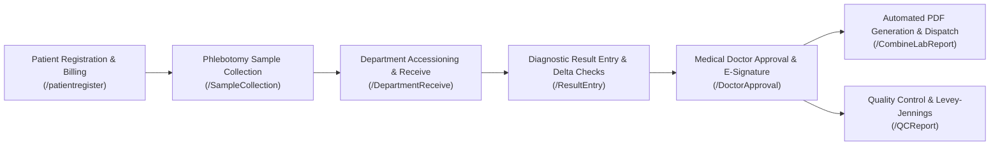

# LabRox LIMS Legacy System Route & Feature Inventory
**Document:** `/docs/LEGACY_INVENTORY.md`  
**Scope:** Exhaustive catalog of all Legacy Frontend Routes, UI Fields, API Endpoints, Workflows, Cronjobs, Reports, Roles, and Menus from the authoritative source (`fe_v9`, `nanjappa_api_v9`, `elabpro-cronjobs`, `nanjappa_reports_v9`).

---

## 1. Core Clinical & Operational Workflows (A5)

---

## 2. Exhaustive Route & Page Catalog (A1 & A2)

### Family 1: Patient Registration, Work Order Booking & Cashier Billing
- **Path:** `/patientregister` (Alias: `/PatientRegistration`, `/WorkOrder`)
- **Component:** `src/Frontend/Laboratory/PatientRegistration.jsx`
- **Title:** Patient Registration & Order Booking POS
- **Purpose:** Primary counter workflow for walk-in and registered patients, biometric demographics, insurance/panel selection, barcode generation, multi-investigation order selection, and multi-tender cashier payment receipting.
- **Fields & Inputs:**
  - *Demographics:* Title (Mr, Mrs, Miss, Baby, Master), First Name, Middle Name, Last Name, Gender (Male, Female, Other), Age / DOB (Year, Month, Days auto-synced), Mobile (10-digit mandatory with validation), Email, Address, City, State, Country, PinCode, VIP Flag, Emergency Contact.
  - *Billing & Panel:* Centre dropdown (multi-centre support), RateType (Cash, Credit, B2B, Insurance Panel), Referral Doctor (DoctorID, Name, Specialization), Collection Centre, Sample Source, Remarks, Referral Lab.
  - *Test Grid:* Dynamic test lookup by Code/Name, Sample Tube Color Indicator, Rate, Discount %, Discount Amount, Net Amount, Delivery Date/Time, Home Delivery checkbox.
  - *Cashier POS:* Total Amount, Discount Total, Paid Amount, Net Due, Payment Mode (Cash, Credit Card, UPI, Cheque, RazorPay), Payment Transaction ID / Reference, Bill Copy Count.
- **Buttons & Modals:**
  - *Buttons:* Save & Print (`SaveData`), Print Bill Only, Add Old Patient, Clear Form, Add Test, Apply Coupon, Generate Barcode (`SC/getBarcode`), Emergency Urgent Flag.
  - *Modals:* Old Patient Search Modal (`GetOldPatientData`), Discount Authorization Modal (`IsValidDiscountAmount`), TRF Document Upload Modal, Receipt Reprint Popup, RazorPay POS Modal.
- **Validations:** Mobile regex `^[0-9]{10}$`, mandatory age/DOB, doctor referral mandatory, at least one test selected, paid amount cannot exceed total without advance deposit.

### Family 2: Phlebotomy & Sample Collection
- **Path:** `/SampleCollection`
- **Component:** `src/Frontend/Laboratory/SampleCollection.jsx`
- **Title:** Phlebotomy Accessioning & Sample Collection
- **Purpose:** Verification of patient identity, sample tube scanning, collection time recording, and barcode labeling.
- **Fields & Filters:** Centre dropdown, Date Range (FromDate, ToDate), Barcode Scan input, Patient ID (UHID), Lab No (LedgerTransactionNo), Department dropdown (Biochemistry, Hematology, Microbiology, Histopathology), Sample Status filter (Pending, Collected, Rejected).
- **Table Columns:** Select Checkbox, Lab No, Barcode No, Patient Name, Age/Gender, Test Name, Sample Type (EDTA, Serum, Fluoride Plasma, Urine), Tube Color, Collection Status, Collected By, Collected Date/Time, Print Barcode button.
- **Actions:** Collect Sample (`SC/SampleCollection`), Reject Sample with Reason Modal (`SC/RejectSample`), Re-print Barcode Label (`SC/getBarcode`).

### Family 3: Department Accessioning & Receive
- **Path:** `/DepartmentReceive`
- **Component:** `src/Frontend/Laboratory/DepartmentReceive.jsx`
- **Title:** Laboratory Accessioning & Specimen Receive
- **Purpose:** Receiving collected samples into the testing department, temperature check, volume adequacy, and transfer to analyzers.
- **Filters & Inputs:** Barcode Scanner input, Department dropdown, Processing Centre, Date Filter, Urgent/Stat filter.
- **Table Columns:** Checkbox, Barcode, Patient UHID, Patient Name, Test List, Specimen Type, Vial Condition, Received By, Received Time, Reject Reason, Accept button.
- **APIs:** `DepartmentReceive/DepartmentReceive`, `DepartmentReceive/RejectSample`.

### Family 4: Diagnostic Result Entry & Delta Checks
- **Path:** `/ResultEntry` (and `/ResultEntry/:id`)
- **Component:** `src/Frontend/Laboratory/ResultEntry.jsx`
- **Title:** Clinical Result Entry & Reference Range Validation
- **Purpose:** Entering quantitative and qualitative test values, calculating ratios, flagging out-of-range critical values, checking historical delta trends, and entering microbiological organism sensitivities.
- **Filters:** Date Range, Centre, Department, Investigation, Status (Pending, Saved, Approved), Machine/Analyzer dropdown, Search (Barcode, UHID, Name).
- **Grid & Entry Fields:** Parameter/Observation Name, Numeric Result Value, Unit of Measurement, Normal Reference Range (Min, Max, Panic Low, Panic High), Flag (Normal, High, Low, Critical Panic), Machine Value auto-import, Previous Historical Result (Delta Check %), Method, Clinical Comments / Remarks.
- **Buttons & Modals:** Save Results (`RE/SaveResultEntry`), Critical Value Notification Modal, Delta Check Trend Chart Modal, Template Remarks Selector (`RE/GetRemarksMaster`), Add Organism (Microbiology culture & sensitivity).

### Family 5: Medical Doctor Approval & Electronic Signatures
- **Path:** `/DoctorApproval` (and `DoctorApproval`, `/Approval`)
- **Component:** `src/Frontend/DoctorApproval/DoctorApproval.jsx`
- **Title:** Clinical Sign-off, Doctor Approval & E-Signature
- **Purpose:** 21 CFR Part 11 electronic review, multi-test batch sign-off, medical re-test order, and cryptographic electronic signature stamp.
- **Filters:** Date Range, Centre, Department, Approval Status (Tested, Doctor Approved, Hold), Doctor dropdown, Barcode.
- **Actions:** Batch Approve (`ChangeResultStatus/ChangeResultStatus`), Medical Hold with Reason, Request Re-run / Re-test, Preview Clinical Report PDF (`Reports/DoctorReport`).

### Family 6: Report Generation, Delivery & Dispatch
- **Path:** `/CombineLabReport` and `/DispatchReport`
- **Component:** `src/Frontend/Laboratory/CombineLabReport.jsx`, `B2BDispatchReport.jsx`
- **Title:** Cumulative Patient Reports & Multi-channel Dispatch
- **Purpose:** Viewing cumulative multi-department patient reports, automated PDF generation, WhatsApp/Email/SMS delivery logs, and cashier delivery confirmation.
- **Filters:** Date Range, Centre, RateType, Patient UHID, Lab No, Delivery Status (Dispatched, Pending, Hold).
- **Actions:** Stream Cumulative PDF Report (`Reports/DoctorReport`), Send Email (`Dispatch/SendEmail`), Send WhatsApp (`Dispatch/SendWhatsApp`), Mark Physical Copy Delivered.

### Family 7: Quality Control (IQC, Westgard, Levey-Jennings)
- **Path:** `/QCReport`, `/qcvalueentry`, `/westgardRuleMaster`, `/qcRemarksMaster`
- **Components:** `src/Frontend/QualityControl/IQC/qcReport/QCReport.jsx`, `qcvalueentry/Qcvalueentry.jsx`, `westgardRuleMaster/WestgardRuleMaster.jsx`
- **Title:** Internal Quality Control, LJ Charts & Westgard Rules
- **Purpose:** Daily control lot value recording, automated Westgard violation detection (1-2s, 1-3s, 2-2s, R-4s, 4-1s, 10-x), and interactive Levey-Jennings charts.
- **Inputs:** Machine ID, Control Lot No, Level (Level 1 Normal, Level 2 High, Level 3 Low), Expiry Date, Assigned Mean, Standard Deviation (SD).
- **Outputs:** Levey-Jennings Plot (SVG/Canvas), Mean Line, ±1SD, ±2SD, ±3SD bands, Out-of-Control Corrective Action Log.

### Family 8: Master Data Management
- **Path:** `/InvestigationMaster`, `/CentreMaster/:name`, `/DoctorMaster`, `/EmployeeMaster`, `/RateListMaster`
- **Components:** `src/Frontend/Master/*`
- **Title:** Laboratory Master Configuration & Pricing Matrices
- **Purpose:** Creating investigations, profiles, packages, reference ranges by age/gender, multi-centre pricing tiers, employee designations, and role-based permissions.

### Family 9: Finance, Invoicing & Cash Flow
- **Path:** `/ReceiptReprint`, `/InvoiceCreation`, `/CashFlow`
- **Components:** `src/Frontend/Invoicing/*`, `src/Frontend/Finance/*`
- **Title:** Invoicing, Ledger Reconciliation & Cashier Shift Handover
- **Purpose:** Reprinting cashier receipts, generating B2B client monthly statements, tracking advance deposits, and daily counter collection reconciliation.

---

## 3. Legacy Backend API Bridge Catalog (A3 & A4)

| Endpoint Path | HTTP Method | Legacy Controller | Target Microservice | DB Tables Touched | Response Contract |
|---|---|---|---|---|---|
| `/api/v1/Login/LoginWithOTP` | POST | `LoginController.cs` | `labrox-iam-service` | `employee_master` | `{success: bool, status: bool, isOTPLogin: bool, message: str}` |
| `/api/v1/Login/login` | POST | `LoginController.cs` | `labrox-iam-service` | `employee_master, centre_master` | `{success: bool, token: str, user: {...}}` |
| `/api/v1/Menu/MainMenuPageData` | GET | `MenuController.cs` | `labrox-iam-service` | `menumaster, pagemaster, role_page_access` | `{status: bool, message: {menuData: [], pageData: []}}` |
| `/api/v1/Centre/GetCentreList` | POST | `CentreController.cs` | `labrox-iam-service` | `centre_master` | `{status: bool, message: [{CentreID, CentreCode, CentreName, ...}]}` |
| `/api/v1/DoctorReferal/getDoctorData`| POST | `DoctorReferalController.cs`| `labrox-iam-service` | `doctor_referal` | `{status: bool, message: [{DoctorID, Name, DoctorCode, ...}]}` |
| `/api/v1/TestData/BindBillingTestData`| POST | `TestDataController.cs` | `labrox-iam-service` | `investigation_master, rate_list` | `{status: bool, message: [{InvestigationID, TestName, Rate, ...}]}` |
| `/api/v1/PatientRegistration/SaveData`| POST | `BookingController.cs` | `labrox-order-service` | `patient_master, f_ledgertransaction, patient_labinvestigation_opd, f_reciept` | `{status: bool, success: bool, message: str, data: {...}}` |
| `/api/v1/PatientRegistration/GetOldPatientData` | POST | `BookingController.cs` | `labrox-order-service` | `patient_master` | `{status: bool, message: [{PatientID, PName, Age, Gender, Mobile, ...}]}` |
| `/api/v1/PatientRegistration/GetAllSampleSources` | GET | `BookingController.cs` | `labrox-order-service` | `samplesource_master` | `{status: bool, message: [{SampleSourceID, SourceName}]}` |
| `/api/v1/SC/GetSampleCollection` | POST | `SampleCollectionController.cs` | `labrox-sample-service` | `patient_labinvestigation_opd, patient_master` | `{status: bool, message: [{LedgerTransactionNo, BarcodeNo, TestName, ...}]}` |
| `/api/v1/SC/SampleCollection` | POST | `SampleCollectionController.cs` | `labrox-sample-service` | `patient_labinvestigation_opd, sample_accession_audit` | `{status: bool, message: "Sample Collected Successfully"}` |
| `/api/v1/SC/getBarcode` | POST | `SampleCollectionController.cs` | `labrox-sample-service` | `barcode_queue` | `{status: bool, message: [{Barcode: str}]}` |
| `/api/v1/DepartmentReceive/DepartmentReceive` | POST | `DepartmentReceiveController.cs`| `labrox-sample-service` | `patient_labinvestigation_opd` | `{status: bool, message: "Specimen Accessioned"}` |
| `/api/v1/RE/GetResultEntry` | POST | `ResultEntryController.cs` | `labrox-diagnostic-service` | `patient_labinvestigation_opd, labobservation_investigation` | `{status: bool, message: [{InvestigationID, ParameterName, Value, ...}]}` |
| `/api/v1/RE/SaveResultEntry` | POST | `ResultEntryController.cs` | `labrox-diagnostic-service` | `patient_labobservation_opd, audit_trail` | `{status: bool, message: "Results Saved & Validated"}` |
| `/api/v1/ChangeResultStatus/ChangeResultStatus` | POST | `ChangeResultStatusController.cs` | `labrox-approval-service` | `patient_labinvestigation_opd, esign_audit` | `{status: bool, message: "Approved with Electronic Signature"}` |
| `/api/v1/DoctorApproval/PatientSearch` | POST | `DoctorApprovalController.cs` | `labrox-approval-service` | `patient_labinvestigation_opd` | `{status: bool, message: [{LedgerTransactionNo, PatientName, ...}]}` |
| `/api/v1/Reports/DoctorReport` | POST | `DoctorReportController.cs` | `labrox-reporting-service` | `patient_labinvestigation_opd, investigation_master` | `application/pdf` (Streamed bytes) |
| `/api/v1/ReceiptReprint/GetReceipt` | POST | `ReceiptReprintController.cs` | `labrox-reporting-service` | `f_reciept` | `{status: bool, message: [{ReceiptNo, Amount, ...}]}` |
| `/api/v1/QC/GetQCData` | POST | `QCValueEntryController.cs` | `labrox-qc-service` | `qc_value_entry, qc_lot_master` | `{status: bool, message: [{LotNo, ControlValue, Mean, SD, ...}]}` |

---

## 4. Legacy Cronjob Catalog (A6)
All cronjobs extracted from `elabpro-cronjobs/jobs`:
1. `labreport_generation_bulk.cs`: Background compilation and S3 archiving of batch clinical PDF reports.
2. `labreport_generation_poct.cs`: Point-of-care rapid test reporting synchronization.
3. `push_email.cs`: Outbox worker dispatching SMTP diagnostic report notifications to patients and doctors.
4. `push_sms.cs`: SMS gateway dispatch for booking confirmation, barcode alerts, and critical values.
5. `push_whatsapp_reports.cs`: WhatsApp Business Cloud API integration dispatching signed PDF links.
6. `sync_machine_data.cs`: TCP/IP ASTM/HL7 analyzer raw data listener translating instrument results into patient result entry.
7. `tat_email.cs`: Turnaround Time (TAT) breach escalations sent hourly to laboratory directors.
8. `sync_booking_hl7.cs`: Bi-directional hospital HIS/EMR order ingestion via HL7 ORM messages.
9. `sync_booking_data_npl.cs`: Remote collection centre order consolidation and sync.
10. `kra_post.cs` & `nplrc_webservice.cs`: Regulatory and government disease reporting sync.

---

## 5. Legacy Reports Catalog (A6)
All 47 report controllers in `nanjappa_reports_v9`:
- `DoctorReportController.cs`: Official 21 CFR Part 11 Clinical Diagnostic Report (PDF with QR code, electronic signatures, reference intervals).
- `receiptController.cs`: Cashier Billing Receipt & Tax Invoice (thermal 3-inch or A4).
- `CollectionReportController.cs`: Daily Cash, Card, UPI, Cheque collection summary by cashier and centre.
- `DueReportController.cs`: Patient outstanding balance and panel receivables ledger.
- `TATMISController.cs`: Turnaround time performance metrics by department, doctor, and test.
- `CombineLabReportController.cs`: Multi-test cumulative patient medical dossier.
- `AuditTrailController.cs`: Hash-chained tamper-evident 21 CFR Part 11 audit trail report.
- `StoreReportsController.cs`: Reagent inventory, expiry alerts, and stock consumption reports.

---

## 6. Roles & Navigation Hierarchy (A7 & A8)
- **Roles:**
  1. `SuperAdmin` (Full access to all 626 pages, configuration, and audit trails)
  2. `Pathologist / Medical Doctor` (Doctor Approval, Result Review, Delta Check, Panic Values)
  3. `Lab Technician` (Accessioning, Department Receive, Result Entry, Instrument Mapping)
  4. `Phlebotomist` (Sample Collection, Barcode Scanning, Home Collection)
  5. `Cashier / Receptionist` (Patient Registration, Work Order Booking, Receipt Reprint, Daily Collection)
  6. `Quality Manager` (IQC, Westgard Rules, LJ Charts, Proficiency Testing)
  7. `Store Manager` (Indent, Purchase Orders, Goods Receipt Note, Stock Expiry)
