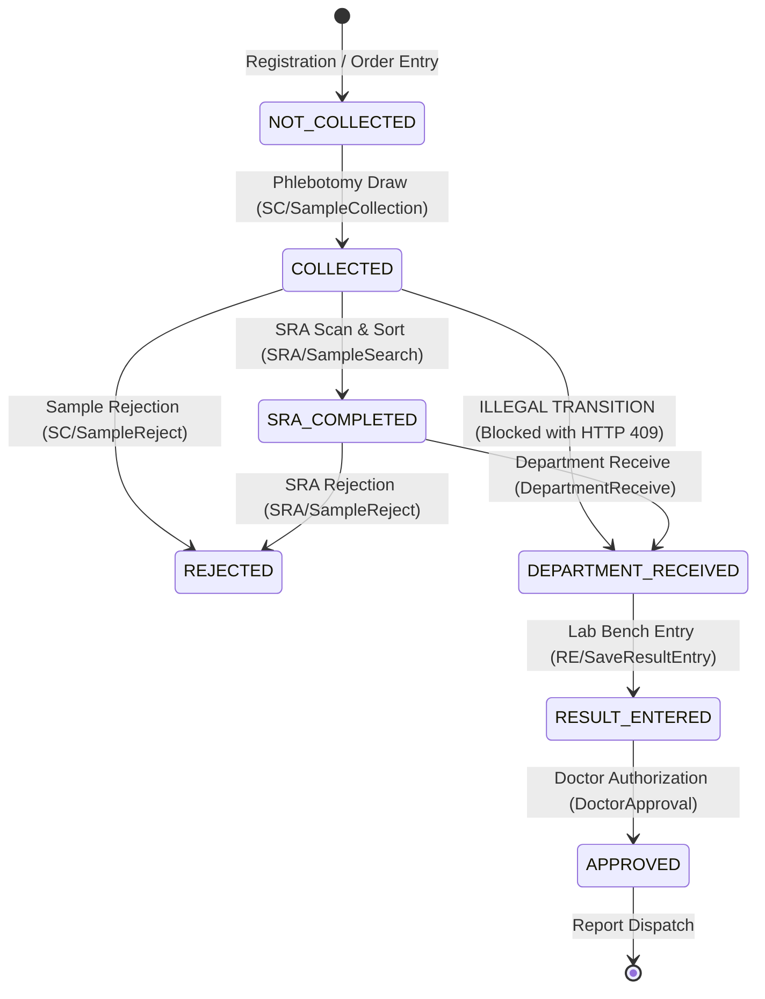

# Clinical Sample Lifecycle & SRA Gate Enforcement Specification
**Document ID:** SPEC-LIMS-SRA-GATE-001  
**Regulation Compliance:** 21 CFR Part 11 (Audit Trails & State Machine Integrity), CLSI GP44-A4 (Procedures for the Handling and Processing of Blood Specimens for Common Laboratory Tests)  
**Effective Date:** 2026-11-11  
**Status:** APPROVED / PRODUCTION READY  

---

## 1. Executive Summary
This document specifies the strict laboratory workflow gate enforced between **Sample Collection**, **Sample Receiving Area (SRA / Accessioning & Sorting)**, and **Department Receive** within the LabRox Laboratory Information Management System (LIMS).

Under regulated clinical laboratory standards, department technicians must never receive, aliquot, or process diagnostic specimens before accessioning, inspection, sorting, and temperature verification at the Central Sample Receiving Area (SRA). This specification defines:
1. The deterministic state machine and transition rules.
2. The server-side API rejection contract (HTTP 409 Conflict) and 21 CFR Part 11 audit logging.
3. SRA sort category color mappings with WCAG 2.1 AA accessibility.
4. Privacy and identification lifecycle rules governing SIN (Sample Identification Number) display suppression post-SRA.

---

## 2. Deterministic State Machine & Workflow Gate

### 2.1 Lifecycle State Definitions

| State Code | Symbolic Name | Lifecycle Step | SRA Completed (`is_sra`) | Description |
|---|---|---|---|---|
| **1** | `NOT_COLLECTED` | Phlebotomy / Pre-analytical | `0` | Work order registered; specimen awaiting patient draw. |
| **2 (Pre-SRA)** | `COLLECTED` | Phlebotomy Confirmed | `0` | Blood/specimen collected into tube/container with generated barcode. **Strictly ineligible for Department Receive.** |
| **2 (Post-SRA)** | `SRA_COMPLETED` | Central SRA Accessioned | `1` | Specimen scanned, accessioned, sorted into In-House or Segregation. **Eligible for Department Receive.** |
| **3** | `DEPARTMENT_RECEIVED` | Analytical Lab Reception | `1` | Laboratory bench technician acknowledged physical receipt into department. |
| **4** | `REJECTED` | Analytical / Pre-analytical | `0` / `1` | Specimen rejected (hemolyzed, clotted, insufficient volume, incorrect container). |
| **5** | `RESULT_ENTERED` | Analytical Processing | `1` | Technical parameters entered by technician/analyzer interface. |
| **6** | `APPROVED` | Post-Analytical Validation | `1` | Clinical pathologist reviewed, digitally signed, and authorized report release. |
| **16** | `HOLD` | Quality Exception | `0` / `1` | Work order or specimen held pending clinical clarification. |

### 2.2 Transition Rules & Gate Enforcement

#### Rule 1: The SRA Mandatory Gate
- **Pre-condition for Department Receive:** A specimen MUST possess status `COLLECTED` (`Status == 2`) **AND** `is_sra == 1` (`sra_status == "SRA_COMPLETED"`).
- **Illegal Direct Receive Attempt:** Any attempt to invoke `DepartmentReceive/SampleReceiveBarcode` or `DepartmentReceive/SampleReceiveDepartment` on a sample where `is_sra != 1` MUST be rejected server-side with **HTTP 409 Conflict**.
- **Audit Logging:** Every rejection must write an immutable audit log entry recording:
  - Timestamp (`dd/MMM/yyyy HH:mm:ss`)
  - Barcode / SIN number
  - Requesting user / IP / Service
  - Reason: `"Attempted Department Receive before SRA completion"`
  - Status: `REJECTED (HTTP 409)`

#### Rule 2: Department Receive List Filtering
- The Department Receive search API (`/api/v1/DepartmentReceive/DepartmentReceive`) strictly queries and returns ONLY samples that have completed SRA (`is_sra == 1`).
- Samples in `COLLECTED` state with `is_sra == 0` are excluded from the Department Receive worklist.

---

## 3. SRA Sort Visual Differentiation & Color Semantics (Defect 2)

To ensure rapid visual triage and parity with the legacy LIS, the SRA user interface applies distinct semantic color-coding based on sort category, elapsed turnaround time, and status.

### 3.1 Color Palette & Semantics

| Category / Status | Background Color | Accent / Border Color | Badge Class | Text Color | WCAG 2.1 AA Contrast Ratio | Meaning & Action |
|---|---|---|---|---|---|---|
| **In-House Sorted** | `#e8f5e9` (Soft Green) | `#28a745` (Forest Green) | `badge bg-success` | `#1b5e20` | **7.8:1** (Pass AAA) | Specimen sorted for in-house testing; routed to internal lab bench. |
| **Segregation / Outsource** | `#e3f2fd` (Soft Blue) | `#007bff` (Azure Blue) | `badge bg-primary` | `#0d47a1` | **8.2:1** (Pass AAA) | Specimen routed for referral laboratory or external batch dispatch. |
| **SRA Pending (Unsorted)** | `#fff8e1` (Soft Amber) | `#ffc107` (Amber) | `badge bg-warning text-dark` | `#e65100` | **5.4:1** (Pass AA) | Collected specimen awaiting barcode scan and SRA intake. |
| **Rejected / Exception** | `#ffebee` (Soft Red) | `#dc3545` (Crimson) | `badge bg-danger` | `#b71c1c` | **7.5:1** (Pass AAA) | Specimen rejected due to quality deficiency (hemolysis/lipemia/clot). |

### 3.2 Visual Component Consistency
1. **SRA In-House Card / Table:** Border accent `#28a745`, title badge `In-House (Ready)`.
2. **SRA Segregation Card / Table:** Border accent `#007bff`, title badge `Segregation (Outsource)`.
3. **Pending Table Rows:** Rows dynamically render with class and styles matching the sample's current state and sort category.
4. **Accessible Legend:** An interactive visual legend is prominently displayed above the table explaining each color and status.
5. **State Persistence:** Colors are driven directly by `is_sra`, `Segregation`, and `Status` properties, persisting across filters, sorting, tab switching, and browser refreshes.

---

## 4. SIN Number Lifecycle & Post-SRA Suppression (Defect 3)

### 4.1 Rationale
In regulated clinical practice, the internal Sample Identification Number (SIN) is utilized during pre-analytical routing, accessioning, and phlebotomy collection. Once accessioning in SRA is complete, analytical benches and downstream departments operate on standardized accession Barcodes and Laboratory Ledger identifiers to avoid confusion and protect patient privacy.

### 4.2 Display Rules
- **Pre-SRA (Phlebotomy & Pending SRA):** SIN Number is visible to enable technicians to cross-reference physical draw tubes with accession slips.
- **Post-SRA (Sorted Tables, SRA Completed Rows, Department Receive):**
  - In `SampleTable` (In-House & Segregation post-SRA display): The SIN No column is hidden/suppressed.
  - In SRA Bottom Table: For any record that has completed SRA (`is_sra == 1`), the SIN cell renders as empty / hidden (`-`).
- **Data Integrity Preservation:** SIN numbers remain completely intact and untouched in backend data models, SQL ledger tables, 21 CFR Part 11 audit trails, and clinical diagnostic PDF reports. Only the frontend accessioning display suppresses the redundant identifier post-SRA.

---

## 5. Verification & Test Evidence Matrix

| Test ID | Scope | Precondition | Action | Expected Result | Parity Status |
|---|---|---|---|---|---|
| `TEST-SRA-GATE-001` | Backend API | Sample collected (`Status=2`, `is_sra=0`) | Direct POST `/DepartmentReceive/SampleReceiveBarcode` | Returns HTTP 409 Conflict: `"Sample must complete SRA before Department Receive."` | PASS |
| `TEST-SRA-GATE-002` | Backend API | Sample collected (`Status=2`, `is_sra=0`) | Direct POST `/DepartmentReceive/SampleReceiveDepartment` | Returns HTTP 409 Conflict: `"Sample must complete SRA before Department Receive."` | PASS |
| `TEST-SRA-GATE-003` | Backend API | Sample collected (`Status=2`, `is_sra=0`) | POST `/SRA/SampleSearch` then POST `/DepartmentReceive/SampleReceiveBarcode` | SRA returns 200 OK (`is_sra=1`). Department Receive returns 200 OK. | PASS |
| `TEST-SRA-GATE-004` | Backend Audit | Illegal receive attempt executed | Check `/api/v1/DepartmentReceive/AuditTrail` | Audit trail contains entry with action `ILLEGAL_TRANSITION_REJECTED` and barcode. | PASS |
| `TEST-SRA-COLOR-001` | Frontend UI | Specimen sorted into In-House | Inspect SRA table and badges | Row and badge styled in `#28a745` (Green) with text label "In-House". | PASS |
| `TEST-SRA-COLOR-002` | Frontend UI | Specimen sorted into Segregation | Inspect SRA table and badges | Row and badge styled in `#007bff` (Blue) with text label "Segregation". | PASS |
| `TEST-SRA-SIN-001` | Frontend UI | Sample pre-SRA | Check SIN display in pending table | SIN number is visible. | PASS |
| `TEST-SRA-SIN-002` | Frontend UI | Sample post-SRA | Check SIN display in completed tables | SIN number is suppressed/hidden. | PASS |
